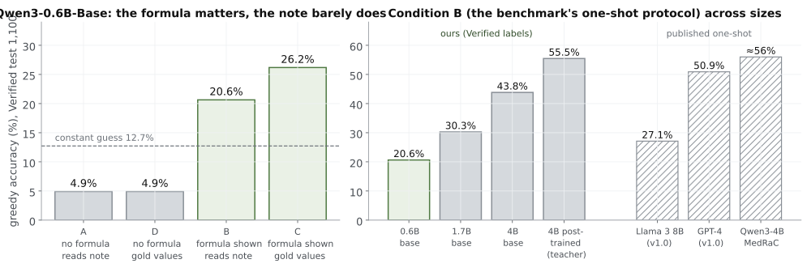
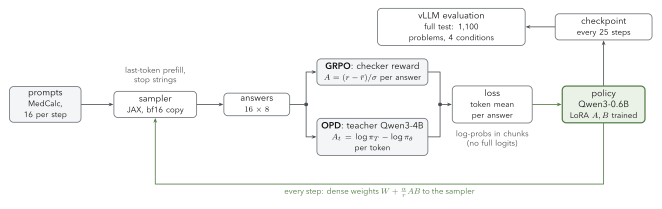
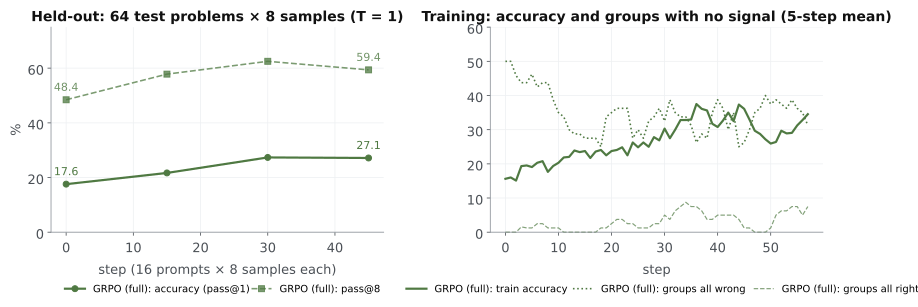
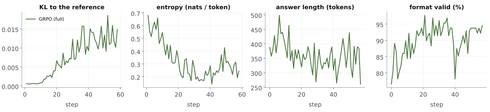
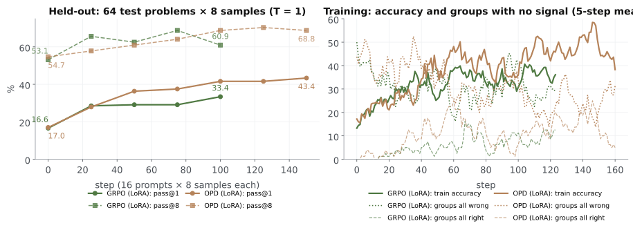
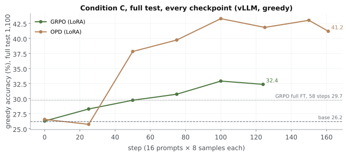
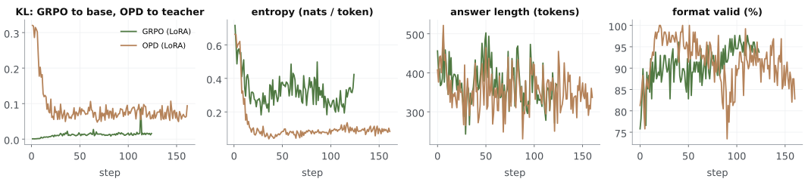
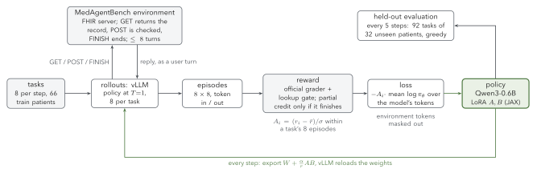
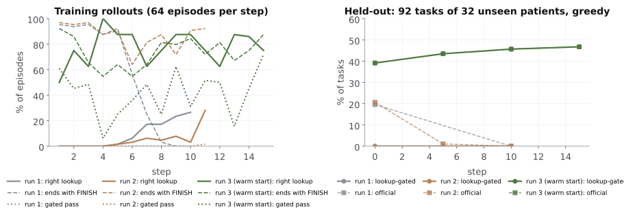

---

<!-- _class: divider -->

###### Part 8

# Experiments: lifting a 0.6B model on clinical calculation and in the health record

GRPO and on-policy distillation on MedCalc-Bench; multi-turn GRPO on MedAgentBench; measured in JAX.

<!--
Everything in this part is measured; every number comes from a result file, and the failures are included. MedCalc-Bench: Qwen3-0.6B-Base, JAX with Tunix for the RL loop. MedAgentBench: Qwen3-0.6B (post-trained), vLLM for rollouts and JAX for the update.
-->

---

<!-- _class: dense small -->

## The experiments: two benchmarks, GRPO and OPD, everything measured

| | |
|---|---|
| **Problem** | a 0.6B model is poor at clinical calculation (**26.2%** with the formula shown, **4.9%** without) and, as an agent in the health record, solves **0%** of tasks for real |
| **Question** | how much can post-training lift it, and *which* skill moves: knowledge (formulas), reading the note, or computation? |
| **Runs** | MedCalc-Bench: base · **GRPO** full fine-tuning (58 steps) and LoRA (124) · **on-policy distillation** from Qwen3-4B, LoRA (161); 16 prompts × 8 samples per step · MedAgentBench: **multi-turn GRPO**, LoRA, 8 tasks × 8 episodes per step |
| **Data** | MedCalc-Bench Verified: train 10,538, test the **full 1,100**, four prompt conditions · MedAgentBench (Stanford, official 300): train on 66 patients' tasks, test on **32 unseen patients' 92 tasks** |
| **System** | **JAX** (our Qwen3, parity with Hugging Face to 10⁻⁴) · Tunix for the RL loop, with our fixes · vLLM for evaluation · agentic: vLLM rollouts + JAX update · 1 GPU per run |
| **Measured** | accuracy, pass@k, the failure type of every answer, KL, entropy, length, the shortcut rate, memory and time per phase |
| **Budget** | **$29** of rented GPU time in total (RunPod billing, both benchmarks, failures included) |

<!--
This slide is the map for the rest of the part: first the baseline and its diagnosis, then GRPO, then LoRA and distillation, then systems and failures.
-->

---

<!-- _footer: "DeepSeek-AI, DeepSeek-R1 (2025), distilled models; Muennighoff et al., s1, arXiv:2501.19393; Gu et al., MiniLLM (ICLR 2024); Agarwal et al., GKD, arXiv:2306.13649 (ICLR 2024); Yang et al., Qwen3, arXiv:2505.09388, §4.5; Shao et al., arXiv:2402.03300; Wang et al., Tina (ICLR 2026)." -->

<!-- _class: dense small -->

## Four ways to teach a small model, and the ones we ran

| Route | What the student learns from | Needs | Known examples | Here |
|---|---|---|---|---|
| **Off-policy distillation** (SFT on traces) | the teacher's own written solutions | a teacher, prompts | DeepSeek-R1-Distill-Qwen (800k R1 traces); s1 (1k traces); m1 (medical) | presented only |
| **On-policy distillation** | the teacher's log-prob of every token the *student* writes | a teacher sharing the tokenizer | MiniLLM, **GKD (ICLR 2024)**; Qwen3's small models (strong-to-weak) | **OPD**, Qwen3-4B → 0.6B, LoRA |
| **RL with a verifier** | a reward on its own answers | a checker, prompts | DeepSeekMath / R1 (GRPO); Tina (LoRA + GRPO, ICLR 2026) | **GRPO**, full and LoRA |
| **RL + distillation** | both: the reward says *whether*, the teacher says *which tokens* | both | **GKD** eq. 5 (ICLR 2024); **VOLD**: GRPO + OPD on the same rollouts (ICLR 2026) | implemented and unit-tested (`grpo_opd`), **not run yet** |

<!--
For a small model, RL is often not the best first move: it can only sharpen what the model already samples (a third of our training prompts never get a correct sample). Distillation brings in what the larger model knows, from its traces (off-policy) or its token-level judgments of the student's own attempts (on-policy). Qwen3's small models were built with strong-to-weak distillation rather than RL for that reason. The combination keeps the verifier as the ground truth while the teacher supplies dense credit.
-->

---

<!-- _footer: "DeepSeek-AI, arXiv:2501.12948 (2025), §4; Muennighoff et al., arXiv:2501.19393; Gu et al., arXiv:2306.08543 (ICLR 2024); Agarwal et al., arXiv:2306.13649 (ICLR 2024), eq. 5; Bousselham et al., VOLD, arXiv:2510.23497 (ICLR 2026); Qwen3, arXiv:2505.09388, §4.5; Thinking Machines (2025): On-Policy Distillation; LoRA Without Regret; Wang et al., arXiv:2504.15777; KDRL, arXiv:2506.02208." -->

<!-- _class: dense small -->

## What each route's key paper showed, in one line

| Paper | Route | The insight |
|---|---|---|
| DeepSeek-R1 | off-policy distillation | distilling a strong reasoner's traces into small models **beats running RL on the small model itself** |
| s1 | off-policy distillation | **1,000 well-chosen traces** plus a test-time budget are enough to get much of the gain |
| MiniLLM (ICLR 2024) | on-policy distillation | train on the **student's own samples** with **reverse KL**: the student covers the teacher's main modes instead of spreading thin |
| GKD (ICLR 2024) | on-policy distillation, and RL + distillation | the student's own mistakes fix the train–test mismatch of SFT; **(1 − α) reward − α divergence** is one regularized RL objective |
| VOLD (ICLR 2026) | RL + distillation | **L = L_GRPO + β · KL(teacher ‖ student)** on the same rollouts (k2 estimate; β = 10⁻³ in its table, 0.1 in its text) beats GRPO alone; needs an SFT cold start when student and teacher differ |
| Qwen3 report | on-policy distillation | its small models came from **strong-to-weak distillation**, better than RL at about a tenth of the GPU hours |
| Thinking Machines, On-Policy Distillation | on-policy distillation | RL's on-policy samples with distillation's dense, per-token reward: **9–30× cheaper** than more SFT |
| KDRL (2025 preprint) | RL + distillation | 1.5B Qwen2.5-lineage student, 6 math benchmarks: SFT 51.5 · GRPO 54.6 · **OPD 56.1** · **GRPO + OPD 57.2** (start 51.4). Joint loss, not reward shaping (that collapsed) |

<!--
The thread through all of them: RL makes a model better at what it can already do; distillation moves in what it cannot yet do; on-policy distillation does the second with the first's machinery. Our experiments place a 0.6B model on this map.
-->

---

<!-- _footer: "Khandekar et al., MedCalc-Bench, arXiv:2406.12036 (NeurIPS 2024); Wang et al., MedCalc-Bench Verified, arXiv:2512.19691 (2025)." -->

<!-- _class: dense -->

## The task: clinical calculators, with answers a program can check

- **Input:** a patient note (or the values extracted from it) and a question, e.g. *"What is the patient's CHA₂DS₂-VASc score?"* **Output:** a number, a date or a gestational age, in `\boxed{}`.
- **55 calculators** in seven families: lab, physical, risk, severity, diagnosis, date, dosage.
- **Data:** MedCalc-Bench **Verified** (physician-reviewed labels): 10,538 train, **1,100 test**, plus one worked example per calculator.
- **Reward:** 1 if the answer falls inside the gold range, else 0. A verifiable reward, so RL needs no reward model.
- **Why this task:** a real use (clinicians use these calculators daily), a checkable answer, and a 0.6B model that starts far from the ceiling.

<!--
The worked example per calculator is the benchmark's own one-shot protocol. It shows the formula, which lets us separate "does not know the formula" from "cannot compute".
-->

---

<!-- _footer: "Our runs: vLLM, greedy, Verified test (1,100). Published: Khandekar et al. (2024), Table 2 (v1.0 labels, 1,047); MedRaC, arXiv:2509.16584, Table 1 (940 cleaned cases; weighted by our category mix)." -->

<!-- _class: figure -->

## Before training: the 0.6B model lacks formulas more than reading skills

> Showing the formula adds **16–21 points**; giving the gold values instead of the note adds **0–6**. At every size the worked example matters most. Our harness reproduces the published Qwen3-4B one-shot result (55.5% vs ≈ 56%).

<!--
A and D are below the constant-guess baseline. The four conditions let us ask after training which skill changed: knowledge (A, D), reading (B vs C), or computation (C).
-->

---

<!-- _footer: "Shao et al., DeepSeekMath, arXiv:2402.03300 (2024), §4.1; Agarwal et al., GKD, arXiv:2306.13649 (2023); Thinking Machines, LoRA Without Regret (2025)." -->

<!-- _class: dense small -->

## One design for every method: same prompts, same steps, same ruler

| | GRPO | OPD |
|---|---|---|
| **Signal for each token** | its answer's group advantage, (r − mean) / std over 8 samples | teacher minus student log-prob of that token |
| **Reference / teacher** | the base model, KL weight 0.04 (k3) | Qwen3-4B (63.4% on the training condition) |
| **Shared** | condition C prompts (worked example + values) · 16 prompts × 8 samples per step · 60 steps · T = 1 · per-sequence token mean · AdamW, clip 1.0 | |
| **Full fine-tuning** | lr 3 × 10⁻⁶ | — (out of memory on one GPU, see the failure log) |
| **LoRA** (rank 32, all projections) | lr 3 × 10⁻⁵ | lr 3 × 10⁻⁵ |
| **Measured** | held-out accuracy every 15 steps (64 test problems × 8); the full test (1,100), four conditions, with vLLM | |

<!--
Same data order and the same held-out set for every run (seed 0). Steps, not hours, are matched. The full-test evaluation uses one engine (vLLM) for every checkpoint: two bf16 engines disagree on about 27% of long greedy answers, so mixing them would add noise.
-->

---

<!-- _footer: "Our implementation: JAX (model, sampler fixes, losses, LoRA merge, chunked log-probs) with Tunix's RL loop; vLLM for evaluation." -->

<!-- _class: figure -->

## One loop for both methods: only the per-token signal differs

> GRPO gives every token of an answer the same advantage, from a checker; OPD gives each token its own, from the teacher. The sampler, the loss, the LoRA update and the evaluation are shared, so the comparison has one variable.

<!--
The green path is what trains: the gradient reaches only the LoRA matrices A and B; after each step the sampler receives the dense equivalent W + (alpha / r) A B, so generation runs at full speed with no adapter overhead. Every 25 steps a checkpoint is exported and scored by vLLM on the full test.
-->

---

<!-- _footer: "Schulman / Thinking Machines, LoRA Without Regret (2025); Thinking Machines, On-Policy Distillation (2025); Wang et al., Tina, arXiv:2504.15777 (ICLR 2026); Medmarks, arXiv:2605.01417; Biderman et al., LoRA Learns Less and Forgets Less, arXiv:2405.09673 (2024)." -->

<!-- _class: dense small -->

## Why LoRA for both RL and distillation: what the papers found, what we chose

| Source | Setting | Finding | Our choice |
|---|---|---|---|
| LoRA Without Regret | policy-gradient RL | LoRA **matches full fine-tuning, even at rank 1**: RL learns about 1 bit per episode | LoRA is enough for GRPO |
| same | SFT and RL | the best LoRA learning rate is **about 10× full fine-tuning's** | lr 3 × 10⁻⁵ (full: 3 × 10⁻⁶) |
| On-Policy Distillation (Thinking Machines) | Qwen3-8B student, math | at rank 32, LoRA trails full fine-tuning by 13% after SFT but **only 6% after on-policy distillation** | **rank 32** for OPD as well |
| Tina (ICLR 2026) | LoRA + GRPO, 1.5B (R1-distilled Qwen2.5) | +20% reasoning, 43.3% AIME24, about **$9**; LoRA mainly learns the *format* of reasoning, knowledge stays | the format-vs-knowledge test is our 2 × 2 |
| Medmarks | LoRA + GRPO, Qwen3-4B, medical incl. MedCalc Verified | LoRA r = 32, α = 64 on all linear layers | r = 32 on all 7 projections |
| LoRA Learns Less and Forgets Less | SFT, code and math | LoRA gains less on the target and **forgets less** elsewhere | measure transfer to A, B, D |

<!--
OPD gives a signal at every token, so it carries far more information per answer than GRPO's one bit; that is why LoRA's capacity could matter more for OPD, and why the Thinking Machines comparison at rank 32 is the one to quote. Our scale alpha / rank = 1; Medmarks used 2.
-->

---

<!-- _footer: "Our run: Qwen3-0.6B-Base, full fine-tuning, vanilla GRPO, 58 steps (time cap), A100." -->

<!-- _class: figure -->

## GRPO climbs for about 30 steps, then plateaus

> Held-out accuracy rises from **17.6% to 27.1%** and pass@8 from **48.4% to 59.4%**. A third of the training prompts never gets a correct sample, so GRPO cannot learn from them: the knowledge ceiling, visible inside training.

<!--
The dotted line is the share of prompts where all 8 samples are wrong; their advantages are all zero. The dashed line is the share where all 8 are right, which also gives no signal. The learnable middle is what GRPO trains on.
-->

---

<!-- _footer: "Our run; metrics logged every step. KL estimator k3 (Schulman); entropy over the full vocabulary." -->

<!-- _class: figure -->

## Inside the climb: confident, concise, and still close to the base

> KL to the base model stays below 0.02 while entropy falls by more than half (0.58 → 0.25 nats per token). Answers get slightly shorter (384 → 351 tokens) and better formed (82% → 93% valid). The typical-value rate averages 4% (peak 15%): no drift to the constant-guess shortcut.

<!--
The logged loss rose during training. That is expected: on-policy, the policy-gradient part of the loss is zero by construction, so the logged loss is β × KL, and it grows as the policy moves away from the base.
-->

---

<!-- _footer: "Our runs: vLLM, Verified test (1,100); pass@k on a 275-problem subset (5 per calculator) with 8 samples at T = 1." -->

<!-- _class: dense small -->

## On the full test, GRPO lifts what the prompt makes possible, not missing knowledge

| Condition (trained on C only) | Greedy accuracy | Sampled accuracy (pass@1) | pass@8 |
|---|---|---|---|
| **C** formula shown, gold values | 26.2 → **29.7** (+3.5) | 15.5 → **24.6** (+9.2) | 52.7 → 58.2 (+5.5) |
| **B** formula shown, reads the note | 20.6 → **22.9** (+2.3) | 10.2 → **17.2** (+7.0) | 38.9 → **48.0** (+9.1) |
| **D** no formula, gold values | 4.9 → 6.5 (+1.6) | 3.1 → 5.0 (+1.8) | 17.8 → 24.4 (+6.5) |
| **A** no formula, reads the note | 4.9 → 5.8 (+0.9) | 2.8 → 3.8 (+1.0) | 17.8 → 19.3 (+1.5) |

- **Sharper and wider:** sampled accuracy gains the most, and pass@8 rises too, so it is not only sharpening.
- **It transfers to reading the note** (B), a condition never trained on.
- **It does not create formulas:** A and D stay near 5%. The knowledge gap from the baseline is still there.
- **Not uniformly better:** on C, 95 problems went wrong → right and **56 right → wrong**; answers more than 50% off fell from 286 to 239.

<!--
Greedy gains are small and sampled gains large: GRPO concentrated the model's distribution on answers it could already produce. The flips are the honest part: a net +39 hides 56 regressions.
-->

---

<!-- _footer: "Our runs: Qwen3-0.6B-Base, LoRA r32 / α32 on all projections, lr 3e-5, 16 prompts × 8 samples per step, 2.9 h each (A100 GRPO, H100 OPD). OPD teacher: Qwen3-4B." -->

<!-- _class: figure -->

## With LoRA on both, OPD keeps climbing where GRPO flattens

> Held-out pass@1 (64 problems × 8 samples, T = 1): GRPO **16.6 → 33.4** by step 100, OPD **17.0 → 43.4** by step 150. Same prompts, same rollouts, same LoRA. The only difference is the per-token signal: a checker's group advantage versus the teacher's log-probs.

<!--
The dotted lines are the prompts where all 8 samples are wrong. GRPO gets exactly zero signal there; OPD still gets a teacher signal on every token. That is the mechanism behind the gap.
-->

---

<!-- _footer: "Our runs: vLLM, greedy, Verified test (1,100), condition C (the training condition), every exported checkpoint. Final policies: GRPO-LoRA at step 124, OPD-LoRA at step 161; we report finals, not the best checkpoint." -->

<!-- _class: figure -->

## On the full test, OPD gains about 15 points and GRPO 6

> Final policies, greedy, all 1,100 problems: GRPO-LoRA **26.3 → 32.4** (+6.1, 124 steps), OPD-LoRA **26.5 → 41.2** (+14.7, 161 steps; peak 43.3). At matched steps LoRA GRPO equals the full fine-tune (29.7 at step 50 and at 58).

<!--
The two step-0 points are the same weights, 0.2 points apart: vLLM's greedy is not bit-reproducible.
Standard error at n = 1,100 is about 1.5 points, so both gains are well outside noise. Step 25 (25.7) is within noise of step 0. OPD's reverse KL to the teacher had already fallen from 0.32 to 0.07 by step 25, so the student matched the teacher's token distribution first; the accuracy gain came between steps 25 and 50.
-->

---

<!-- _footer: "Our runs; metrics logged every step. GRPO: k3 KL to the base model (β = 0.04). OPD: reverse KL to the teacher, k1 estimate on the student's samples." -->

<!-- _class: figure -->

## Inside: GRPO stays near the base, OPD moves toward the teacher

> GRPO's KL to the base model rises only to **0.015**; its entropy falls **0.59 → 0.33**. OPD's reverse KL to the teacher falls **0.31 → 0.07** and its entropy drops to **0.09**: the student takes on the teacher's confidence. Both answer shorter (≈ 400 → ≈ 340 tokens); GRPO ends better formed (**95%** vs **87%** valid).

<!--
The KL panel holds two different quantities, labeled as such: GRPO is regularized toward where it started, OPD is pulled toward where the teacher is. Values: first-5-step mean to last-10-step mean.
-->

---

<!-- _footer: "Our runs: vLLM, Verified test (1,100); greedy on all; pass@k on a 275-problem subset (5 per calculator), 8 samples at T = 1. Final policies. Sampled: T 0.7, top-p 0.8, top-k 20 (Qwen3 card), mean of 4." -->

<!-- _class: dense small -->

## All four conditions: OPD transfers to reading the note; nobody learns the formulas

| Condition (all trained on C) | Base | GRPO full (58) | GRPO LoRA (124) | OPD LoRA (161) |
|---|---|---|---|---|
| **C** formula shown, gold values | 26.2 / 15.5 / 52.7 | 29.7 / 24.6 / 58.2 | 32.4 / 25.0 / 59.3 | **41.2 / 39.1 / 62.5** |
| **B** formula shown, reads the note | 20.6 / 10.2 / 38.9 | 22.9 / 17.2 / 48.0 | 22.5 / 15.8 / 43.6 | **31.5 / 27.7 / 49.8** |
| **D** no formula, gold values | 4.9 / 3.1 / 17.8 | 6.5 / 5.0 / 24.4 | 6.8 / 3.8 / 16.0 | 8.2 / 6.1 / 22.9 |
| **A** no formula, reads the note | 4.9 / 2.8 / 17.8 | 5.8 / 3.8 / 19.3 | 5.5 / 3.0 / 14.9 | 6.9 / 5.8 / 21.8 |

Each cell: greedy accuracy / pass@1 / pass@8 (%).

- **OPD transfers:** B rises **+10.9** (20.6 → 31.5) without being trained on it; GRPO-LoRA moves B by +1.9.
- **The formulas stay missing:** A and D stay below 9% for every method. A teacher on formula-shown prompts does not install the formulas.
- **Greedy is the honest number here:** sampled at the model card's setting, mean of 4: base **25.9**, GRPO full **29.0**, GRPO-LoRA **31.6**, OPD-LoRA **40.9**, each within 1.3 points of greedy.

<!--
The pass@8 column says whether a method widens what the model can reach or only sharpens it. OPD lifts pass@1 by 23.6 points but pass@8 by 9.8: mostly sharpening, some widening. GRPO-LoRA's pass@8 on A and D falls below the base (14.9 vs 17.8, 16.0 vs 17.8): sharpening at the cost of breadth off the training condition.
-->

---

<!-- _footer: "Our measurements on A40 / A100 / H100, JAX 0.11.2 + Tunix 0.1.7. Logits: 8 rows × 2,048 tokens × 151,936 vocabulary × 4 bytes." -->

<!-- _class: dense small -->

## Memory went to the vocabulary, time to generation

| What we measured | Number | What it means, and the fix |
|---|---|---|
| model + gradients + AdamW (0.6B, fp32) | **8.9 GiB** | small: the model is not the problem |
| fp32 logits for one 8-row micro-batch | **9.3 GiB** | bigger than the model. Fix: log-probs and entropy in 128-token chunks, **−45% memory** when scoring, identical log-probs |
| Tunix's eval loss over 512 answers at once | **297 GiB** request | crashed run 1. Fix: evaluate in training-sized chunks |
| JAX's default memory cap | **75%** (59.4 of 80 GB) | crashed OPD. Fix: raise the cap to 95% |
| resident memory, LoRA vs full | GRPO **5.9** vs 11.1 GiB; OPD **12.3** vs 17.5 | LoRA drops the full gradients and AdamW state |
| generation, share of a step | **56%** of 50 s | the bottleneck, as in the literature |
| one 64-row generate call | **14.0 s at every step**; **35%** of the decode work useful | static batches run to the slowest row; each step reads 15 GB of KV cache vs 1.2 GB of weights. Next: vLLM or length-aware decode |
| Tunix's sampler vs vLLM | **643 vs 3,001** tok/s | we added last-token prefill and stop strings |

<!--
Two lessons that transfer to any scale. First, at small model size and large vocabulary, the [rows × tokens × vocabulary] tensors dominate memory; chunk them. Second, generation dominates time, and a static-batch sampler wastes most of it; this is why every production RL framework uses vLLM or SGLang for rollouts.
-->

---

<!-- _footer: "Khandekar et al., arXiv:2406.12036; Wang et al., arXiv:2512.19691; MedRaC, arXiv:2509.16584; MedCalc-Bench audit, arXiv:2603.02222; MedCalc-Eval, arXiv:2510.27267; Jiang et al., MedAgentBench, arXiv:2501.14654; Anthropic (Jan 2026)." -->

<!-- _class: dense small -->

## The reference benchmarks: one task family, several versions, and an agent benchmark

| Benchmark | What it tests | Test set | Note | Best reported |
|---|---|---|---|---|
| **MedCalc-Bench v1.0** (NeurIPS 2024) | 55 calculators from patient notes | 1,047 | ≥ 27% of labels later found wrong | GPT-4 one-shot 50.9; MedCalc-R1 3B (SFT + GRPO) 51.3 |
| **MedCalc-Bench Verified** (2025) | the same, physician-reviewed labels | **1,100** | **used here** | Qwen3-8B + GRPO 64.2; open-book GLM-4.6V 81.5 |
| MedRaC, cleaned (EMNLP 2025) | formula, extraction and arithmetic graded step by step | 940 | stricter tolerance | Qwen3-14B one-shot 60.8 rule / 67.1 equation |
| MedCalc-Eval (2025) | a larger calculator set, with an RL environment | — | RL there did not transfer to MedCalc-Bench | Qwen3-235B zero-shot 31.1 |
| **MedAgentBench** (Stanford, 2025) | an **agent** in a simulated health record (FHIR): look up labs, order drugs, refer | 300 tasks, 10 categories, 98 patients with records | physician-written tasks | paper: Claude 3.5 Sonnet v2 69.7; Anthropic chart (64k thinking, native tools): Opus 4.5 92.3 |

<!--
The open-book result is the headline of the audit paper: giving the model the calculator's specification lifts a strong model from 52% to 82%. That is the same knowledge gap our 2 × 2 measures on a 0.6B model (B − A = +16 points). MedAgentBench is the agentic counterpart: the next step for this line of work is an environment, not a single answer.
-->

---

<!-- _footer: "Anthropic, Advancing Claude in healthcare and the life sciences (Jan 2026); Khandekar et al., arXiv:2406.12036, Table 2; MedRaC, arXiv:2509.16584; MedCalc-R1, arXiv:2608.08623; Med-U1, arXiv:2506.12307; Wang et al., arXiv:2512.19691." -->

<!-- _class: dense small -->

## Where a 0.6B model stands among public MedCalc-Bench results

| Model | Size | Method | Tools / thinking | Labels | Accuracy |
|---|---|---|---|---|---|
| Claude Opus 4.5 · Sonnet 4.5 · Haiku 4.5 | — | frontier model | Python + 64k thinking | n/s | 61.3 · 54.4 · 47.9 |
| Qwen3-8B, GRPO (Verified paper) | 8B | GRPO, 300 steps × 256 prompts | none | Verified | 29.7 → 64.2 |
| GPT-4 | — | one-shot | none | v1.0 | 50.9 |
| Qwen2.5-3B · 1.5B (MedCalc-R1) | 3B · 1.5B | SFT → GRPO | none | v1.0 | 51.3 · 42.4 |
| Qwen2.5-3B (Med-U1) | 3B | GRPO | none | n/s | 15.4 → 39.1 |
| **Qwen3-4B, our teacher** | 4B | post-trained, one-shot | none | Verified | **55.5** |
| **Qwen3-0.6B-Base** | 0.6B | one-shot | none | Verified | **20.6** |
| **+ GRPO, 58 steps (full fine-tuning)** | 0.6B | trained on condition C | none | Verified | **22.9** (pass@8 38.9 → 48.0) |
| **+ GRPO, 124 steps (LoRA)** | 0.6B | trained on condition C | none | Verified | **22.5** (pass@8 38.9 → 43.6) |
| **+ OPD from Qwen3-4B, 161 steps (LoRA)** | 0.6B | trained on condition C | none | Verified | **31.5** (pass@8 38.9 → 49.8) |

<!--
Our rows are the standard one-shot protocol (condition B, reading the note), so they compare with the one-shot rows. They are not a leaderboard entry: the published runs train 10–80 times longer, on models 2.5–13 times larger, and the Claude numbers use code execution. The point is the starting line and the direction of travel on a 0.6B model. n/s = not stated.
-->

---

<!-- _footer: "Stanford MedAgentBench (Jiang et al., arXiv:2501.14654), official v2 task file and grader (refsol.py), HAPI FHIR image jyxsu6/medagentbench. Our checks: experiments/x3_mab_agentic." -->

<!-- _class: dense small -->

## MedAgentBench: before training anything, we checked the ruler

| What we checked | Result |
|---|---|
| our RL environment vs the official harness | **1,500 recorded episodes replayed: 0 mismatches** in replies, statuses and grades |
| an independent oracle (what each task asks) | graded correct on **300 / 300** official tasks |
| the do-nothing shortcut, `FINISH([])` at once | **70 / 300 = 23.3%**, by the agent run and by direct calculation |
| training tasks | none shipped. The server's 597 other patients have **no clinical data** (0 observations) |
| our split, by patient | train **66 patients, 208 tasks** · held out **32 patients, 92 tasks** (9–10 per type) |
| the same model, greedy, run twice | **285 / 300** same outcome: vLLM greedy is not bit-reproducible (≈ ±1 point) |

- **Why it matters:** POSTs never reach the server, and three conditional tasks accept "no order". A reward taken straight from the grader pays for doing nothing.

<!--
The 23.3% was computed two independent ways and agrees exactly. Published floors differ (41.7% in one paper) because they use a 600-task set, not the official 300.
-->

---

<!-- _footer: "Our runs: vLLM, greedy, thinking off, official harness, 300 tasks. Lookup-gated = official pass and a successful GET of the patient's record or lab. Sampling check: 208 training tasks × 8 at T = 1." -->

<!-- _class: dense small -->

## The 0.6B's 6% is a guess, and RL has nothing to learn from

| Agent | Official | Lookup-gated |
|---|---|---|
| do-nothing | 23.3% | **0%** |
| Qwen3-0.6B | 6.3% / 5.3% (two runs) | **0%** |
| Qwen3-1.7B | 9.0% | **9.0%** |
| Qwen3-4B | 8.3% | **1.7%** |

- **Every 0.6B pass is `FINISH([-1])`,** after a failed lookup (17) or none (2). It writes the literal `{api_base}` placeholder into the URL, and −1 ("not available") happens to be right for 19 of 30 magnesium questions.
- **It knows what to ask, not how.** In its lab-lookup samples at T = 1, the commonest request is the right query with the placeholder (**162×**); with the real URL it asks for the first listed function, Condition (**83×**); never both at once.
- **Shortcut-proof reward:** **0 of 1,664** samples rewarded, so **0 of 208** GRPO groups carry a signal. Cold-start GRPO cannot start.

<!--
This is the measured answer to "do we need a warm-up before RL?" at 0.6B: with an honest reward, yes, or a reward that credits the halves it gets right. The 1.7B is the only size whose passes are all real.
-->

---

<!-- _footer: "Our trainer: experiments/x3_mab_agentic/train_agentic_grpo.py, one RTX A5000 (24 GB): vLLM 0.31 for rollouts, JAX 0.11.2 for the update. LoRA r32 / α32, lr 3e-5, β = 0 (no reference model)." -->

<!-- _class: figure -->

## How agentic RL runs: vLLM plays the episodes, JAX learns from them

> One step: 8 tasks × 8 episodes, each a conversation with the health record, up to 8 turns. The grader scores each finished episode; the policy gradient flows only through the tokens the model wrote. The new weights go back to vLLM before the next step, so every episode is sampled from the current policy (on-policy).

<!--
Why two engines: generation dominates RL time (56% of a MedCalc step with our own sampler), and vLLM batches the 64 episodes as they diverge in length. JAX keeps the update transparent. The check that the two copies agree: vLLM's log-prob of each sampled token versus JAX's, mean gap 0.01-0.03 nats per token.
Token in, token out: the trainer sends vLLM token ids and receives token ids, so the sequence it trains on is exactly what was sampled; no re-tokenizing the text.
-->

---

<!-- _footer: "A real episode: Qwen3-1.7B on official task7_28 (most recent glucose of patient S6534835), passed. Token counts with the Qwen3 tokenizer. Training caps environment replies at 3,000 characters." -->

<!-- _class: dense small -->

## One episode, token by token: what the model writes is all that is trained

| Turn | Who | What (abridged) | Tokens | In the loss? |
|---|---|---|---|---|
| 0 | prompt | rules, 9 FHIR function specs, context, question: *"What is the most recent CBG of the patient S6534835?"* | 3,309 | no: context |
| 1 | **model** | `GET https://…/fhir/Observation?code=GLU&patient=S6534835` | **43** | **yes** |
| 2 | environment | *"Here is the response from the GET request:"* the patient's glucose records as FHIR JSON | 2,435 | no: masked |
| 3 | **model** | `FINISH([140.0])` | **9** | **yes** |

- **52 of 5,796 content tokens are the model's.** Every one of them gets the episode's advantage; the 5,744 others are only context.
- **Reward:** the official grader checks 140.0 against the latest glucose in the record, and the lookup gate checks turn 1 → **1.0**.
- **If it had looped** GET after GET without FINISH, the reward is 0. Our first run paid partial credit for lookups without a FINISH, and the policy learned exactly that loop (next slide).

<!--
This is the credit-assignment problem of agentic RL in one picture: one number at the end, spread over the few tokens the model chose, across turns separated by thousands of tokens the environment chose.
-->

---

<!-- _footer: "Our run grpo-shaped-lora32-t4k (A5000), stopped at step 10. Shaped reward: 1 for a gated pass; else +0.1 real URL, +0.1 right request, +0.2 successful lookup. Held-out: 92 tasks, greedy, our driver." -->

<!-- _class: dense small -->

## Run 1: GRPO learned the lookup, then learned to never answer

| Step | 1 | 3 | 5 | 6 | 7 | 8 | 9 | 10 |
|---|---|---|---|---|---|---|---|---|
| right lookup made (% of 64 episodes) | 0 | 0 | 1.6 | 6.2 | 17.2 | 17.2 | 23.4 | **26.6** |
| episodes that end with FINISH | 61 | 61 | 59 | 36 | 16 | 2 | 0 | **0** |
| groups with a signal (of 8) | 5 | 7 | 1 | 6 | 6 | 7 | 7 | 4 |

- **The partial credit worked as a teacher:** from 0 of 1,664 samples to a correct lookup in a quarter of episodes in 10 steps.
- **Then the reward was hacked:** the credit did not require a FINISH, so the cheapest 0.4 was to keep issuing GETs until the round limit. Held-out official **19.6% → 0%**, lookup-gated **0% → 0%**: 85 of 92 episodes hit the limit.
- **Fix, one line:** partial credit only for an episode that ends with FINISH. Run 2 starts again from the base model.

<!--
The textbook lesson, measured: an RL agent optimizes the reward you wrote, not the one you meant. The 19.6% it lost was never skill: those passes were guesses. What it gained (the lookup) is real, and the held-out gated score is the number that would show it.
-->

---

<!-- _footer: "Our run sft-then-grpo-lora32 (A5000): 235 of 328 oracle demos kept (gated pass, no truncated reply, answer inside the trained window); SFT on LoRA r32, lr 1e-4, 2 epochs, 13 min; then 15 GRPO steps (finish-gated reward). Held-out: greedy, our driver (256 tokens per turn, replies capped at 3,000 characters)." -->

<!-- _class: dense small -->

## Warm start, then RL: real success 0% → 39% → 47%

| Held-out: 92 tasks of 32 unseen patients | Cold start (runs 1, 2) | After SFT warm-up | + 15 GRPO steps |
|---|---|---|---|
| **real success** (lookup-gated) | 0% | **39.1%** (36) | **46.7%** (43) |
| official success | 0% | 39.1%: every pass is real | 46.7%: every pass is real |
| **official protocol** (default template, 2,048 tokens per turn, full replies) | base model: 6.5% (0% real) | | **46.7%, all real** |

| | find patient | age | record BP | referral | Mg 24 h | Mg + order | avg glucose | glucose | K + order | HbA1C |
|---|---|---|---|---|---|---|---|---|---|---|
| after SFT | 8 / 9 | 0 / 9 | 9 / 9 | 9 / 9 | 3 / 9 | 1 / 10 | 0 / 10 | 1 / 9 | 0 / 9 | 5 / 9 |
| + GRPO | 8 / 9 | 0 / 9 | 9 / 9 | 9 / 9 | 0 / 9 | **9 / 10** | 2 / 10 | 1 / 9 | **4 / 9** | 1 / 9 |

- **SFT taught the protocol:** the real URL, the right resource, the exact payloads. That solves patient search, vitals and referrals for unseen patients.
- **RL then learned the conditionals:** "check the level, order only if low" went from 1 to 13 of 19. In their words, "SFT to inject codes, RL to learn conditionals." Most of those correct answers are "no order needed", the common case.
- **Not free:** it lost value-reporting tasks (Mg 24 h 3 → 0, HbA1C 5 → 1); net +7 (≥ 14 gained, 7 lost), not yet significant. **Age stays at 0**: 51 demos show the age, not the arithmetic.

<!--
The warm start is not distillation from a model: the demos come from the grader's own logic (the oracle that scored 300 / 300), replayed through the real environment. After SFT the policy is nearly deterministic (entropy 0.003-0.03 nats per token), so most of GRPO's groups have identical samples; only 1-5 of 8 carry a signal each step. Exploration is the next problem.
-->

---

<!-- _footer: "Our runs on one A5000: run 1 shaped reward without a FINISH requirement (stopped at step 10); run 2 with it (stopped at 11); run 3 the same reward after the SFT warm-up (15 steps, its step 0 is after SFT)." -->

<!-- _class: figure -->

## Three runs, one picture: RL needs a model that sometimes succeeds

> Cold start, the agent never succeeds and RL has nothing to reinforce: run 1 hacks the reward, run 2 stays at 0%. After 235 demonstrations it starts at 39%, and GRPO climbs from there to 46.7% on patients it never saw.

---

<!-- _class: divider -->

###### Part 9

# Research questions and use cases

What this setup can answer next, and where it is useful.

---

<!-- _class: dense small -->

## Questions this setup can answer, each one controlled comparison

| Question | How we measure it | What we have so far |
|---|---|---|
| **Which skill does post-training move:** knowledge, reading or computation? | the 2 × 2 before and after | GRPO lifts computation and transfer to reading (B); formulas (A, D) barely move |
| **Does RL sharpen or expand?** | pass@1 vs pass@8 on the full test | GRPO raised both (C: +9.2 / +5.5), so not only sharpening |
| **Distillation vs RL** | GRPO vs OPD at matched steps and prompts | running tonight |
| **Does LoRA forget less** (knowledge collapse)? | gain on C vs change on A, B, D; general-knowledge probes | LoRA vs full GRPO, tonight |
| **Can RL teach a model to abstain** when it cannot know? | reward +1 correct, 0 "cannot determine", −λ wrong; coverage vs accuracy | next |
| **How much do wrong labels hurt?** | the same run on v1.2 vs Verified labels | next |
| **Tools vs weights** | a Python calculator in the loop (agentic RL), as in the frontier numbers | next (agent track) |

<!--
Each row is one controlled change on the same base, the same prompts and the same ruler. The paper direction leans toward the knowledge-collapse and epistemic rows; the talk shows the ground they stand on.
-->

---

<!-- _class: dense -->

## Where a small post-trained model is useful

- **A bedside calculator assistant:** reads a note, picks the calculator, shows the computation; small enough to run on hospital hardware, so patient data stays local.
- **A distilled specialist:** a 4B teacher's skill moved into a 0.6B student with on-policy distillation, at a fraction of the serving cost.
- **An agent in the health record:** MedAgentBench-style tasks (look up, order, refer) need RL with an environment, the next step from single answers.
- **A model that says "I can't determine this"** instead of a confident wrong number: the epistemic question above, and the one that matters most clinically.

<!--
None of these is claimed by tonight's results; they are the uses the measurements point toward. The common thread: measure which skill a method moves, before trusting it in a clinical setting.
-->
