<!-- _class: title -->
<!-- _header: "" -->
<!-- _paginate: false -->

# Post-training LLMs with RL and On-Policy Distillation

<p class="subtitle">From policy gradients to PPO, GRPO and on-policy distillation</p>

**Prabakaran Chandran**

Engineer / Applied Researcher · pracha.me

<!--
Twenty minutes on the ideas, then twenty on experiments, then questions. No RL background is assumed: every symbol is defined before it is used, and the same notation runs through the whole talk.
-->

---

<!-- _class: topics -->

## Outline

1. **Overview**: what post-training adds, and what this talk measures
2. **Primer**: the ideas, the systems and the tools
   - RL in four ideas · a language model as a policy · human preferences and DPO
   - reasoning and GRPO · learning from a teacher (OPD, OPSD) · systems and infrastructure · JAX
3. **Experiments**: GRPO and on-policy distillation on Qwen3-0.6B, a clinical calculation task
4. **Research questions and use cases**: what this setup can answer next
5. **Appendix**: experiment bookkeeping, decoder details, GRPO refinements

---

<!-- _footer: "OLMo 3: Team Olmo, arXiv:2512.13961 (2025). Qwen3: Yang et al., arXiv:2505.09388 (2025), §4.5. Lambert, RLHF book (rlhfbook.com), ch. 3." -->

<!-- _class: figure -->

## Post-training turns a next-token predictor into a useful model

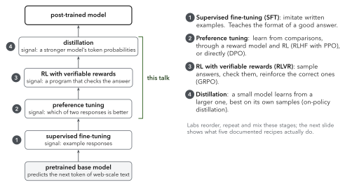

<!--
A pretrained model only continues text. Post-training teaches it what to do with what it knows. Four signals do most of the work: examples, comparisons, checkers and a stronger model. This talk covers the RL-based stages and on-policy distillation. Stress the footnote: real recipes mix and repeat stages.
-->

---

<!-- _footer: "Team Olmo, OLMo 3, arXiv:2512.13961 (2025); DeepSeek-AI, DeepSeek-R1, arXiv:2501.12948 (2025); Yang et al., Qwen3, arXiv:2505.09388 (2025), §4; NVIDIA, Nemotron 3 Ultra technical report (2026), §3; Thinking Machines Lab, Inkling and Inkling-Small announcements (2026)." -->

<!-- _class: dense small -->

## Real recipes use some of the stages, in their own order

| Model | Documented post-training sequence | SFT | Preference | RLVR | Distillation |
|---|---|---|---|---|---|
| OLMo 3 Think (fully open) | SFT on reasoning traces from QwQ-32B and DeepSeek-R1 → DPO → RLVR | ✓ | ✓ DPO | ✓ | off-policy, through the SFT data |
| DeepSeek-R1 | SFT → reasoning RL (GRPO) → SFT on its own filtered samples → RL with rules and reward models | ✓ | ✓ reward models | ✓ | off-policy, for the R1-Distill students |
| Qwen3 | largest models: SFT → reasoning RL → SFT → general RL; small models: distilled from the large ones | ✓ | ✓ reward models | ✓ | off-policy, then on-policy (small models) |
| Nemotron 3 Ultra | SFT on teacher traces → RLVR (GRPO) → on-policy distillation from more than ten teachers | ✓ | inside one teacher | ✓ | off-policy and on-policy |
| Inkling-Small | on-policy distillation from Inkling → agentic RL | | | ✓ RL | on-policy |

> No single checkpoint is documented going through all four stages in order. Nemotron 3 Ultra comes closest; OLMo 3 is the fully open reference, with data and code released.

<!--
Answer to "has any model gone through everything": Nemotron 3 Ultra documents all four, but its preference tuning lives inside one of the teachers it distils from. OLMo 3 is the one to study end to end because everything is released.
-->

---

<!-- _class: dense small -->

## One notation for the whole talk

| Symbol | Name | In a language model |
|---|---|---|
| $x$ | prompt | the question or instruction |
| $y = (y_1,\dots,y_T)$ | response | the tokens the model writes |
| $s_t = (x, y_{<t})$ | state | the prompt and the tokens written so far |
| $a_t = y_t$ | action | the next token |
| $\pi_\theta(y_t \mid x, y_{<t})$ | policy | the model being trained, with parameters $\theta$ |
| $\pi_{\mathrm{old}}$, $\pi_{\mathrm{ref}}$ | sampling policy, reference | the snapshot that wrote the batch; a frozen copy of the starting model |
| $y_w$, $y_l$ | preferred, rejected response | the two sides of one comparison |
| $r(x, y)$ | reward | a score for the whole response, from a reward model $r_\phi$ or a checker |
| $V_\psi(s_t)$ | value (critic) | the predicted final reward from state $s_t$ |
| $\hat A_t$ | advantage | how much better than expected the action turned out |
| $\pi_T$ | teacher | a stronger model whose token probabilities we learn from |

<!--
Keep this slide on screen for a moment; every later equation uses only these symbols. Green in the figures marks the thing being trained or the point of the figure; grey marks frozen or external parts.
-->

---

<!-- _class: divider -->

###### Part 1

# Reinforcement learning in four ideas

Policy and return, the policy gradient, the critic, and a safe step size (PPO).

---

<!-- _footer: "Sutton & Barto, Reinforcement Learning: An Introduction, 2nd ed. (2018), ch. 3; OpenAI Spinning Up, Part 1: Key Concepts in RL." -->

<!-- _class: figtext -->

## An agent learns from the consequences of its own actions

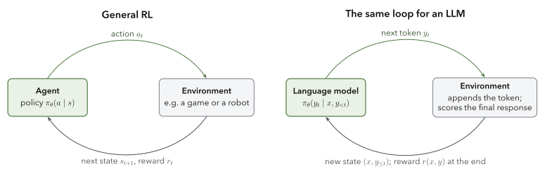

- **Policy** $\pi_\theta(a \mid s)$: the probability of taking action $a$ in state $s$; $\theta$ are the parameters we train.
- **Trajectory** $\tau = (s_0, a_0, r_0, s_1, \dots)$ and **return** $R(\tau) = \sum_t r_t$: the total reward of one episode.
- **Goal**: choose $\theta$ to maximize the expected return $J(\theta) = \mathbb{E}_{\tau \sim \pi_\theta}[R(\tau)]$.

<!--
The only difference between the two panels is what an action is. For an LLM the environment is trivial while writing (it appends the token) and gives a reward only when the response is finished.
-->

---

<!-- _footer: "Williams (1992), REINFORCE; Sutton et al. (2000), policy gradient theorem; OpenAI Spinning Up, Part 3: Intro to Policy Optimization." -->

<!-- _class: figtext -->

## The policy gradient: make good actions more likely

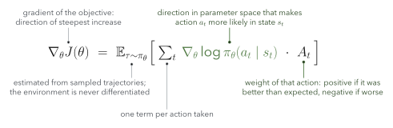

- **Where it comes from**: $\nabla_\theta p_\theta(\tau) = p_\theta(\tau)\,\nabla_\theta \log p_\theta(\tau)$, and the environment's probabilities do not depend on $\theta$, so only the policy's terms remain.
- **How to read it**: a weighted log-likelihood. With every weight equal to 1 and tokens from a dataset, this is exactly the supervised fine-tuning gradient.

<!--
This one line is the root of everything in the talk. PPO, GRPO and on-policy distillation all keep the grad-log-pi term and differ only in how they compute the weight.
-->

---

<!-- _footer: "Sutton & Barto (2018), §13.4 (REINFORCE with baseline); Schulman et al., GAE, arXiv:1506.02438 (2016), eq. 16." -->

<!-- _class: figure -->

## Actor–critic: a second network learns what to expect

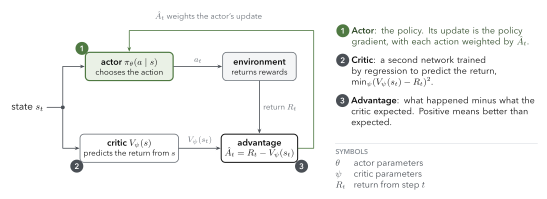

> **Why a baseline**: raw returns are noisy. Subtracting $V_\psi(s_t)$ leaves the expected gradient unchanged, because $\mathbb{E}_{a\sim\pi}[\nabla_\theta \log \pi_\theta(a\mid s)] = 0$, and removes much of the noise.

<!--
The critic answers "how good is this state, on average?" The advantage is then a surprise: positive means the action did better than the critic predicted. In practice PPO estimates the advantage with GAE, a smoothed sum of one-step errors delta_t = r_t + V(s_{t+1}) - V(s_t); name it and move on, because GRPO removes the critic anyway.
-->

---

<!-- _footer: "Schulman et al., Proximal Policy Optimization Algorithms, arXiv:1707.06347 (2017), eq. 7 and Algorithm 1. The paper writes r_t(θ) for the ratio; we write ρ_t to keep r for reward." -->

<!-- _class: figtext -->

## PPO limits how far one update can move the policy

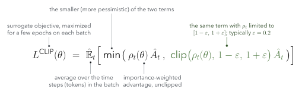

- **The ratio** $\rho_t(\theta) = \dfrac{\pi_\theta(a_t \mid s_t)}{\pi_{\mathrm{old}}(a_t \mid s_t)}$ lets us reuse one batch of samples for several gradient steps.
- **The clip** removes any incentive to move $\rho_t$ outside $[1-\varepsilon, 1+\varepsilon]$, so a single batch cannot push the policy far.

<!--
Without the clip, the same batch would be optimized until the ratio explodes and the policy collapses. TRPO solved this with a KL constraint; PPO gets most of the benefit with a min and a clip.
-->

---

<!-- _footer: "Schulman et al. (2017), Figure 1 (redrawn, schematic)." -->

<!-- _class: figure -->

## The clip, drawn: no gain from moving too far

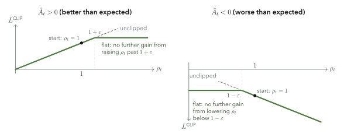

> **Reading the plot**: for a good action the objective rises with $\rho_t$ until $1+\varepsilon$, then goes flat; for a bad action it falls until $1-\varepsilon$, then goes flat. A flat objective has zero gradient, so updates stop there.

<!--
Point at the black dot: every update starts at ratio 1, because the sampling policy and the current policy are the same at the start of an iteration.
-->

---

<!-- _class: divider -->

###### Part 2

# A language model is a policy

Tokens are actions, the prompt and the text so far are the state, and the reward comes at the end.

---

<!-- _footer: "Qwen3-0.6B config.json and model card (huggingface.co/Qwen/Qwen3-0.6B): vocabulary 151,936, 28 layers." -->

<!-- _class: figure -->

## The model maps a context to a distribution over the next token

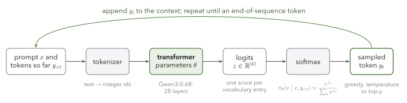

> Generation repeats one step: score every token in the vocabulary, turn the scores into probabilities with a softmax, sample one, append it. That probability, $\pi_\theta(y_t \mid x, y_{<t})$, is the policy.

<!--
Everything RL needs from the model is this distribution and the log-probability of the token that was actually sampled.
-->

---

<!-- _footer: "Qwen3 technical report, arXiv:2505.09388, §2 and Table 1; config.json of Qwen/Qwen3-0.6B. Weight counts computed from the config." -->

<!-- _class: figure tall -->

## Inside Qwen3-0.6B: 28 identical decoder layers on a residual stream

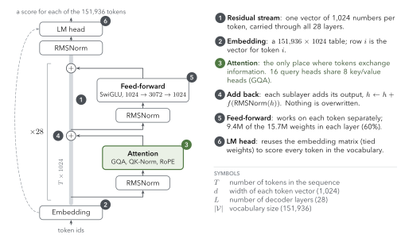

<!--
Walk the numbers bottom to top. The point for this talk: whatever post-training method we use, it changes these same weights, and it only ever reads the output distribution at the top. The appendix zooms into the attention and feed-forward sublayers.
-->

---

<!-- _footer: "Shao et al., DeepSeekMath, arXiv:2402.03300 (2024), §4.1.2: with an outcome reward, every token of a response gets the same advantage." -->

<!-- _class: figtext -->

## Generating a response is a sequence of decisions

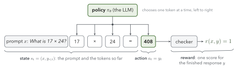

| RL | Language model |
|---|---|
| state $s_t$, action $a_t$ | the context $(x, y_{<t})$, the next token $y_t$ |
| reward | usually one number for the finished response, from a reward model or a checker |

<!--
The key consequence: the reward arrives once, at the end, so the method has to decide how much credit each token gets. PPO asks the critic; GRPO gives every token the same credit; on-policy distillation gives each token its own score.
-->

---

<!-- _footer: "Code tested on CPU with JAX 0.11.2. Next-token alignment: logits at position t score token t+1." -->

<!-- _class: concept -->

## Every loss in this talk is built from token log-probabilities

#### Definition
$\log \pi_\theta(y \mid x) = \sum_t \log \pi_\theta(y_t \mid x, y_{<t})$: one forward pass over prompt and response gives the log-probability of every response token.

#### In code

```python
def token_logprobs(logits, targets):
    """logits: [B, T, V] scores for the next token; targets: [B, T] the token that came next."""
    logp = jax.nn.log_softmax(logits, axis=-1)
    return jnp.take_along_axis(logp, targets[..., None], axis=-1)[..., 0]   # [B, T]

logits = apply_fn(params, ids)[:, :-1]          # position t scores token t+1
logp = token_logprobs(logits, ids[:, 1:])       # mask out the prompt before summing
```

#### Why it matters
PPO, GRPO and on-policy distillation differ only in the weight they put on each of these numbers.

<!--
If someone remembers one thing from part 2, it is this function. The rest of the talk is about where the weights come from.
-->

---

<!-- _class: divider -->

###### Part 3

# Learning from human preferences: RLHF and DPO

Collect comparisons, learn a reward, optimize it with PPO, or skip the RL loop with DPO.

---

<!-- _footer: "Ouyang et al., Training language models to follow instructions with human feedback (InstructGPT), arXiv:2203.02155 (2022), Figure 2 and §3. Christiano et al., arXiv:1706.03741 (2017)." -->

<!-- _class: figure -->

## RLHF: learn a reward from people, then optimize it with PPO

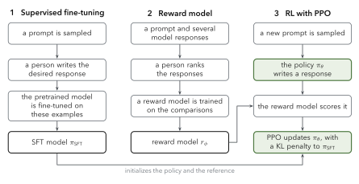

> People are better at comparing two answers than at writing a score. Step 2 turns comparisons into a reward model; step 3 optimizes the policy against it.

<!--
InstructGPT asked labellers to rank between 4 and 9 model outputs per prompt. The SFT model is used twice more: it initializes the policy, and it is the reference for the KL penalty.
-->


---

<!-- _footer: "Ouyang et al. (2022), §3.4–3.5; Touvron et al., Llama 2, arXiv:2307.09288 (2023), §3.2.1–3.2.2; Bai et al., Constitutional AI, arXiv:2212.08073 (2022), §4; Cui et al., UltraFeedback, arXiv:2310.01377 (2023), §2." -->

<!-- _class: figtext -->

## Preference data: people rank the model's own samples

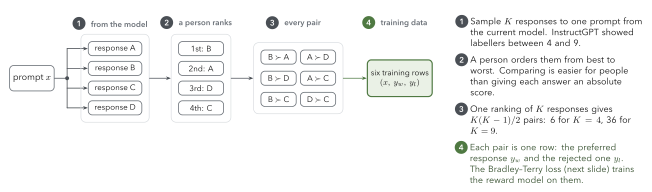

- **Labels are noisy.** InstructGPT's roughly 40 labellers agreed with each other 72.6 ± 1.5% of the time, so a reward model cannot be much more certain than that.
- **Other formats.** Pick one of two and say how much better (Llama 2: four levels, over 1.4 million comparisons), or let an AI judge: Constitutional AI for harmlessness, UltraFeedback with GPT-4 rating four completions on four aspects.

<!--
All comparisons from one prompt go into a single batch element in InstructGPT, to avoid overfitting to that prompt. Llama 2 also uses the strength level as a margin in the reward-model loss.
-->

---

<!-- _footer: "Bradley & Terry (1952); Ouyang et al. (2022), §3.5, eq. 1; Lambert, RLHF book, ch. 5 (Reward Modeling)." -->

<!-- _class: figtext -->

## A reward model is a classifier trained on comparisons

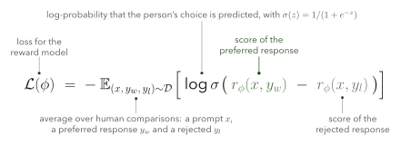

- **The model** (Bradley–Terry): $P(y_w \succ y_l \mid x) = \sigma\big(r_\phi(x,y_w) - r_\phi(x,y_l)\big)$. Only score differences matter.
- **The network** is usually an LLM with a single scalar output, read at the last token of the response.

<!--
It is logistic regression on a score gap. Once trained, the reward model is frozen and used as the scoring function during RL.
-->

---

<!-- _footer: "Kullback & Leibler (1951); Lambert, RLHF book, ch. 15 (Regularization)." -->

<!-- _class: figtext -->

## KL divergence measures how far the policy has moved

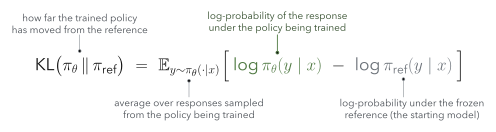

- **Properties**: $\mathrm{KL} \ge 0$, and it is $0$ only when the two distributions are equal. It is not symmetric; RLHF measures it under the policy's own samples.
- **Per token**: since $\log \pi(y\mid x) = \sum_t \log \pi(y_t \mid x, y_{<t})$, the penalty splits into one term per token.

<!--
Read the bracket as: for each response the policy writes, how much more confident is the policy than the reference? Averaged, that is the KL.
-->

---

<!-- _footer: "Gao, Schulman & Hilton, Scaling Laws for Reward Model Overoptimization, arXiv:2210.10760 (2022). Toy distributions; the KL values are computed, not typed." -->

<!-- _class: figure -->

## Why penalize KL: the reward model is only a proxy

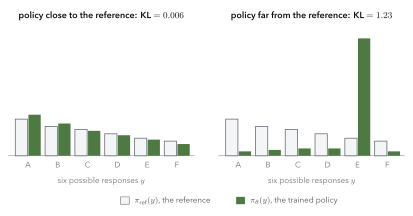

> Optimized hard, a policy moves its probability onto responses the reward model overrates (right). Gao et al. measure the true quality rising, then falling, as the KL from the starting policy grows.

<!--
The right panel is the picture of reward hacking: one response, E, has taken most of the probability. A KL penalty makes that move expensive.
-->

---

<!-- _footer: "Ouyang et al. (2022), §3.5, eq. 2 (without the pretraining-mix term); Ziegler et al., arXiv:1909.08593 (2019); Stiennon et al., arXiv:2009.01325 (2020)." -->

<!-- _class: figtext -->

## The RLHF objective: reward minus a KL penalty

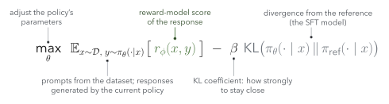

- **Two forces**: the first term pulls toward high reward; the second keeps the policy close to the SFT model, which keeps its language fluent and limits reward hacking.
- $\beta$ **sets the balance**. Too small and the policy exploits the reward model; too large and it barely changes.

<!--
This objective is the target; PPO is the optimizer that maximizes it.
-->

---

<!-- _footer: "Ouyang et al. (2022), §3.5: \"The value function is initialized from the RM\"; Huang et al., The N Implementation Details of RLHF with PPO (Hugging Face blog, 2023)." -->

<!-- _class: figure -->

## PPO for an LLM keeps four models in memory

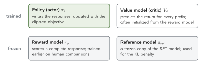

> Two are trained and two are frozen, and all four are transformers. For a large policy this is the main memory and engineering cost of PPO-based RLHF; Part 6 counts the bytes.

<!--
Name the roles out loud: the actor writes, the critic predicts, the reward model judges, the reference anchors.
-->

---

<!-- _footer: "Ziegler et al. (2019) and Huang et al. (2023): the KL penalty enters as a per-token reward; Schulman et al. (2017), Algorithm 1." -->

<!-- _class: figure -->

## One PPO iteration, step by step

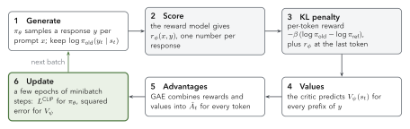

> Steps 1–5 only compute numbers; step 6 is the only place where gradients flow. Most of the wall-clock time goes to step 1, generation.

<!--
Trace one batch around the loop. If short on time, read only the bold step names.
-->


---

<!-- _footer: "Gao, Schulman & Hilton, arXiv:2210.10760 (2022), §1 and Fig. 1 (curves here are illustrative); Singhal et al., arXiv:2310.03716 (2023), §3.1; Sharma et al., arXiv:2310.13548 (2023), §4; Weng, Reward Hacking in Reinforcement Learning (Lil'Log, 2024)." -->

<!-- _class: figtext -->

## Optimized too hard, the policy exploits the reward model

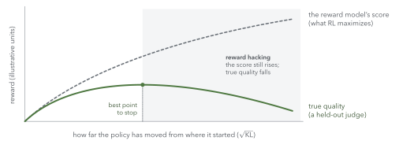

- **Measured**: Gao et al. optimize a policy against a proxy reward model and score it with a larger "gold" one. The gold score rises, then falls, as $\sqrt{\mathrm{KL}}$ grows.
- **What it looks like**: longer answers (in two of three RLHF setups, length explains 70–90% of the reward gain; Singhal et al.), and sycophancy, agreeing with the user over being correct (Sharma et al.).

<!--
Reward hacking is not a bug in PPO: any optimizer pushed hard against an imperfect score finds the score's blind spots. Lilian Weng's post is the best long read.
-->

---

<!-- _footer: "Ziegler et al., arXiv:1909.08593 (2019); Gao et al. (2022); Coste et al., arXiv:2310.02743 (2023); Eisenstein et al., arXiv:2312.09244 (2023); Touvron et al., Llama 2 (2023), §3.2.1, §3.2.3; DeepSeek-AI, DeepSeek-R1, arXiv:2501.12948, v1 (2025), §2.2.2." -->

<!-- _class: dense small -->

## Five ways to limit reward hacking

| Fix | Why it helps | Source |
|---|---|---|
| **KL penalty** to the reference | moving far from the starting model becomes expensive | Ziegler et al. (2019); InstructGPT |
| **Stop early**, choosing the checkpoint with a held-out judge | true quality peaks before the proxy score does | Gao et al. (2022) |
| **Reward-model ensembles**, optimizing the worst case | a blind spot of one model is less likely to be shared by all | Coste et al. (2023); Eisenstein et al. (2023): ensembles mitigate but do not eliminate it |
| **Refresh the reward model** with comparisons of the current policy's outputs | keeps the reward model on the distribution it is scoring | Llama 2: iterative RLHF, versions V1 to V5 |
| **Replace the learned reward with a checker** wherever an answer can be checked | a rule cannot be flattered | DeepSeek-R1: neural reward models "may suffer from reward hacking in the large-scale reinforcement learning process" |

<!--
The last row is the bridge to Part 4: where a program can check the answer, reasoning RL uses it instead of a learned reward.
-->

---

<!-- _footer: "Rafailov et al., Direct Preference Optimization: Your Language Model is Secretly a Reward Model, arXiv:2305.18290 (NeurIPS 2023), §4, Eqs. 4–7; full derivation in App. A.1–A.2." -->

<!-- _class: figure -->

## DPO: the RLHF objective has a closed-form optimum

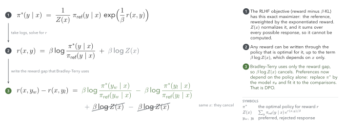

> The reward model is implicit in the policy. Writing the reward through the optimal policy makes the intractable $Z(x)$ cancel, so the comparisons can train the policy directly.

<!--
Three moves: (1) the known optimum of reward minus beta-KL, (2) solve it for the reward, (3) Bradley–Terry needs only reward differences, and Z(x) is the same for both responses to the same prompt.
-->

---

<!-- _footer: "Rafailov et al. (2023), §4: Eq. 7 and \"What does the DPO update do?\"." -->

<!-- _class: figtext -->

## The DPO loss: Bradley–Terry on the policy's own log-ratios

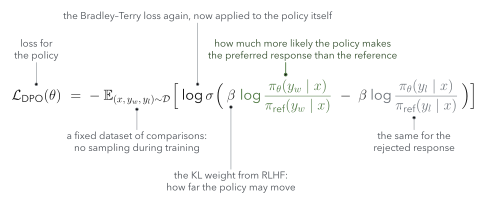

- **The gradient** raises $\log\pi_\theta(y_w\mid x)$ and lowers $\log\pi_\theta(y_l\mid x)$, weighted by $\sigma\big(\hat r_\theta(x,y_l) - \hat r_\theta(x,y_w)\big)$, where $\hat r_\theta = \beta\log\frac{\pi_\theta}{\pi_{\mathrm{ref}}}$: most when the implicit reward orders the pair wrongly.
- **What it needs**: the policy and a frozen reference, two responses per row; no sampling, no reward model, no critic.

<!--
The weighting matters: the DPO paper reports that without it the model degenerates.
-->

---

<!-- _footer: "Ouyang et al. (2022); Touvron et al., Llama 2 (2023); Tunstall et al., Zephyr, arXiv:2310.16944 (2023); Ivison et al., Tülu 2, arXiv:2311.10702 (2023); Llama 3, arXiv:2407.21783 (2024); Lambert et al., Tülu 3 (2024); Team Olmo, OLMo 3 (2025)." -->

<!-- _class: dense small -->

## Online RL or an offline preference loss

| | PPO (RLHF) | DPO |
|---|---|---|
| **Data** | fresh samples from the current policy at every step (on-policy) | a fixed set of comparisons (offline) |
| **Models in memory** | policy, critic, reward model, reference | policy, reference |
| **Signal** | reward-model score and a per-token KL; advantages from the critic | the gap between the two log-ratios |
| **Strength** | samples new responses, so it can find better ones than the dataset holds, as judged by the reward model | simple and cheap: a supervised-style loss with few hyperparameters |
| **Weakness** | costly to run, many hyperparameters, exposed to reward hacking | learns only from the responses in the data; no exploration |
| **Used by** | InstructGPT; Llama 2 | Zephyr; Tülu 2; Llama 3 (each round); Tülu 3 and OLMo 3, before RLVR |

<!--
Modern recipes often use both: DPO for broad preferences, then online RL where a checker exists. That is the OLMo 3 order.
-->


---

<!-- _class: divider -->

###### Part 4

# Reasoning: chain-of-thought, test-time compute and verifiable rewards

Let the model think in tokens, spend more compute on a problem, then train the thinking with RL against a checker.

---

<!-- _footer: "Wei et al., Chain-of-Thought Prompting Elicits Reasoning in Large Language Models, arXiv:2201.11903 (2022), Figure 1 and §3.2; Kojima et al., arXiv:2205.11916 (2022), Table 1." -->

<!-- _class: figure -->

## Chain-of-thought: the model writes its working before the answer

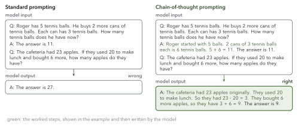

> Each written step is one more forward pass the answer can build on. With eight such examples, PaLM 540B went from 17.9% to 56.9% on GSM8K; the gain appears only at about 100B parameters.

<!--
The example is the paper's own Figure 1. Zero-shot works too: "Let's think step by step" took GSM8K from 10.4% to 40.7% with text-davinci-002 (Kojima et al., Table 1). The point for RL: if worked steps help, a model can be trained to write good ones, which is what reasoning RL does.
-->

---

<!-- _footer: "Wang et al., arXiv:2203.11171 (2022); Cobbe et al., arXiv:2110.14168 (2021); Lightman et al., arXiv:2305.20050 (2023), Fig. 3; Yao et al., arXiv:2305.10601 (2023); Snell et al., arXiv:2408.03314 (2024); OpenAI, Learning to Reason with LLMs (2024)." -->

<!-- _class: figure -->

## Test-time compute: spend more inference on the same problem

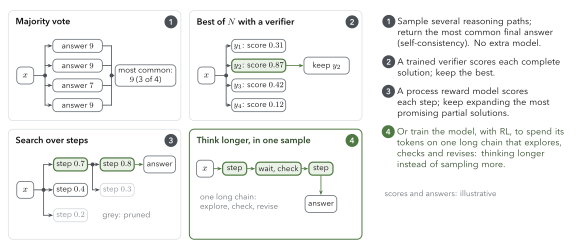

> Majority vote over 40 samples added 17.9 points on GSM8K (PaLM 540B); best-of-1860 with a process reward model solved 78.2% of a MATH subset.

<!--
OpenAI on o1: performance "consistently improves with more reinforcement learning (train-time compute) and with more time spent thinking (test-time compute)". Snell et al. add the cost view: on problems a smaller model can sometimes solve, test-time search can beat a 14x larger model at matched FLOPs. Panel 4 is what the rest of this part trains.
-->

---

<!-- _footer: "Lambert et al., Tülu 3, arXiv:2411.15124 (2024), §6, Eqs. 7–8; DeepSeek-AI, DeepSeek-R1, arXiv:2501.12948, v1 (2025), §2.2.2; Hugging Face, Math-Verify (github.com/huggingface/Math-Verify); Team Olmo, OLMo 3 (2025), §4.4.1." -->

<!-- _class: figtext -->

## RL with verifiable rewards: a program checks the answer

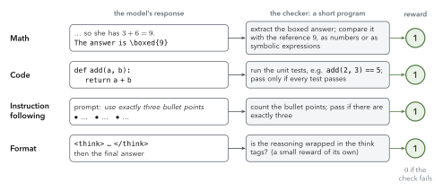

- **RLVR** (the name is from Tülu 3) swaps the learned reward model for a checker: Tülu 3 gives a reward of 10 when the answer verifies and 0 otherwise; DeepSeek-R1-Zero adds a format reward for the think tags.
- **Math checkers** extract the final answer and compare it with the reference, symbolically where needed (Math-Verify; OLMo 3 uses SymPy). Code checkers run tests.

<!--
Checkers exist only where answers can be checked: math, code, constrained instructions, some puzzles. Open-ended writing still needs a learned or LLM judge.
-->

---

<!-- _footer: "Shao et al., DeepSeekMath, arXiv:2402.03300 (2024), §4.1.1." -->

<!-- _class: figure -->

## GRPO removes the critic

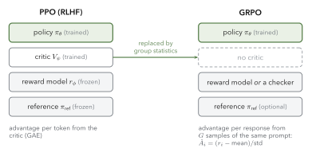

> **Why**: the critic is as large as the policy, and a value for every token is hard to learn when the reward arrives only at the last one. **Instead**, GRPO samples $G$ responses to the same prompt and uses their mean reward as the baseline.

<!--
Same goal as the critic, a baseline, obtained by sampling instead of learning.
-->

---

<!-- _footer: "Shao et al. (2024), §4.1.2 (outcome supervision). Worked example." -->

<!-- _class: figure -->

## GRPO on one prompt

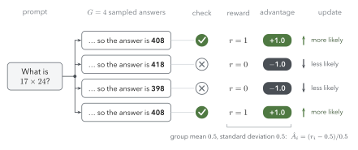

> Correct answers move up and wrong ones move down, by an amount set by how the response compares with its siblings. Every token of a response gets that response's advantage.

<!--
If all four had been correct, every advantage would be zero and the prompt would teach nothing. That is why later recipes filter or resample such prompts.
-->

---

<!-- _footer: "Shao et al. (2024), §4.1.2. Code tested with JAX 0.11.2. Liu et al., Dr. GRPO, arXiv:2503.20783 (2025), proposes dropping the division by the standard deviation." -->

<!-- _class: figtext -->

## The GRPO advantage is the reward, standardized within its group

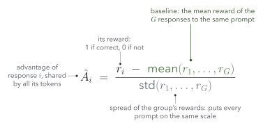

```python
def grpo_advantages(rewards, eps=1e-6):
    """rewards: [num_prompts, G], one row per prompt's group of G responses."""
    mean = rewards.mean(axis=1, keepdims=True)
    std = rewards.std(axis=1, keepdims=True)
    return (rewards - mean) / (std + eps)      # [[1, 0, 0, 1]] -> [[1, -1, -1, 1]]
```

<!--
It is a z-score. The division by the standard deviation is debated: Dr. GRPO argues it gives very easy and very hard prompts too much weight.
-->

---

<!-- _footer: "Shao et al. (2024), eq. 3 (objective) and eq. 4 (the KL estimator)." -->

<!-- _class: figtext -->

## The GRPO objective is PPO's, with the group advantage

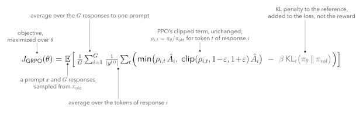

- **Same as PPO**: the probability ratio $\rho_{i,t}$ and the clip.
- **Different**: $\hat A_i$ comes from the group, not a critic, and the KL penalty is added to the loss with the estimator $\frac{\pi_{\mathrm{ref}}}{\pi_\theta} - \log\frac{\pi_{\mathrm{ref}}}{\pi_\theta} - 1 \ge 0$.

<!--
Point at the clip term: it is literally PPO's. The only new piece is A-hat-i.
-->

---

<!-- _footer: "DeepSeek-AI, DeepSeek-R1, arXiv:2501.12948, v1 (2025), §2.2.4, Fig. 2–3, Table 2; Yue et al., arXiv:2504.13837 (2025)." -->

<!-- _class: concept -->

## GRPO and checkers fit together; one question is still open

#### Why they fit
A checker gives one trustworthy reward per response. GRPO needs only that reward and a group to compare it with: no critic and no reward model to train.

#### What it produced
DeepSeek-R1-Zero, trained with GRPO and rule-only rewards straight from the base model: AIME 2024 pass@1 rose from 15.6% to 71.0% (86.7% with majority voting), and its responses grew longer as training went on.

#### Open question
Does RLVR teach new abilities, or make the model more reliable at ones it had? Yue et al. find RL improves pass@1 but the base model can match it at large pass@$k$; later work disputes how general this is.

<!--
Keep the open question honest: it is an active debate, and it is one of the questions our experiments can probe at small scale. The numbers are from R1's first arXiv version; the January 2026 revision reports 77.9%.
-->

---

<!-- _footer: "Zhong et al., Seq2SQL, arXiv:1709.00103 (2017); Zelikman et al., STaR, arXiv:2203.14465 (2022); Le et al., CodeRL, arXiv:2207.01780 (2022); Luong et al., ReFT, arXiv:2401.08967 (2024); Shao et al., DeepSeekMath (2024), §4.2 and Table 10; OpenAI (2024); Lambert et al. (2024); DeepSeek-AI (2025)." -->

<!-- _class: figure -->

## Where RL on checkable answers came from

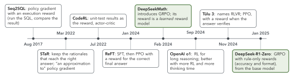

> DeepSeekMath introduced GRPO, but its reward was a learned reward model. Rewards from checkers go back to 2017–2022, Tülu 3 named RLVR, and DeepSeek-R1-Zero combined GRPO with rule-only rewards. Events are in order, not to scale.

<!--
This answers "was DeepSeekMath the first?": first for GRPO, not for RL against a checker. Kimi k1.5 appeared the same day as R1, but still used a learned chain-of-thought reward model for math.
-->
---

<!-- _class: divider -->

###### Part 5

# Learning from a teacher

On-policy distillation, and the model as its own teacher.

---

<!-- _footer: "Agarwal et al., GKD, arXiv:2306.13649 (2023); Lu (Thinking Machines Lab), On-Policy Distillation (2025); Zhao et al., OPSD, arXiv:2601.18734 (2026)." -->

<!-- _class: figure -->

## Three ways to learn from a teacher

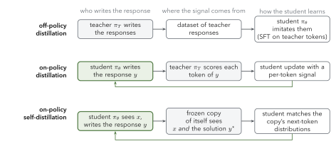

> **Off-policy**: the student imitates states the teacher visited. **On-policy**: the student learns on its own responses, so it is corrected where it actually makes mistakes.

<!--
The off-policy problem: at test time the student's own early mistakes lead it into states the teacher's data never covered. Training on its own samples fixes exactly that.
-->

---

<!-- _footer: "Lu (Thinking Machines Lab), On-Policy Distillation (2025): RL gives one score per episode; distillation gives one per token. Illustrative values." -->

<!-- _class: figure -->

## Where the learning signal lands

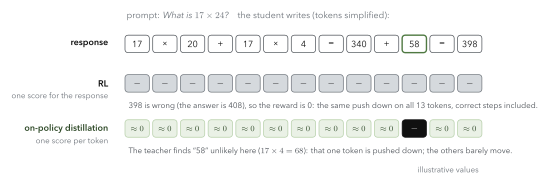

> RL has to discover which token was wrong from a single number. On-policy distillation is told, token by token, which choices the teacher would not have made.

<!--
This is the intuition for why on-policy distillation needs far fewer samples than RL to reach the same quality, when a good teacher exists.
-->

---

<!-- _footer: "Lu (2025), Thinking Machines blog: per-token reverse KL, discount 0. Qwen3 report, arXiv:2505.09388, §4.5 and Table 21." -->

<!-- _class: figtext -->

## On-policy distillation: the teacher scores every token

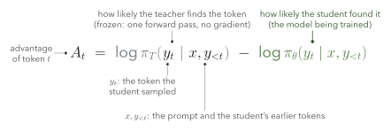

- **Same machinery as RL**: plug $A_t$ into the policy-gradient loss. Averaged over the student's samples, $-A_t$ is the reverse KL from student to teacher.
- **Cost**: Qwen3-8B reached 74.4 on AIME'24 with 1,800 GPU-hours of on-policy distillation, against 67.6 with 17,920 GPU-hours of RL. In this basic form, teacher and student must share a tokenizer.

<!--
The teacher only runs a forward pass on the student's tokens; it never generates. That is why it is cheap.
-->

---

<!-- _footer: "Zhao et al., Self-Distilled Reasoner: On-Policy Self-Distillation for LLMs, arXiv:2601.18734 (2026), §3.2 and §4.1." -->

<!-- _class: figure -->

## On-policy self-distillation: the model, shown the solution, is its own teacher

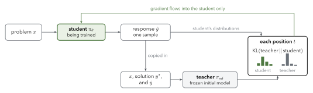

> No stronger model is needed, only reference solutions. The teacher is a frozen copy of the starting model that reads the solution before scoring the student's response.

<!--
The intuition: a model that has seen the answer can tell, token by token, which steps of an attempt lead toward it.
-->

---

<!-- _footer: "Zhao et al. (2026), eq. 6 and 8, §4.1–4.3, Table 2 (Avg@12); Kaur et al., arXiv:2607.05184 (2026)." -->

<!-- _class: figtext -->

## The OPSD loss and what it buys

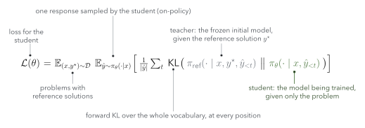

- **Results** (Zhao et al.): Qwen3-1.7B on AIME 24/25 and HMMT 25 averaged 37.7 with GRPO and 43.4 with OPSD (base: 37.1), using one rollout of up to 1k tokens per problem instead of GRPO's eight of up to 16k.
- **Caveat**: Kaur et al. report that this kind of self-distillation can hurt models that reason at length, by suppressing self-correction.

<!--
Forward KL over the full vocabulary was the best variant in the paper's ablations; the sampled-token version did worse.
-->

---

<!-- _footer: "Summary of the slides above." -->

<!-- _class: dense small -->

## Four methods, one loop

| | PPO (RLHF) | GRPO | On-policy distillation | On-policy self-distillation |
|---|---|---|---|---|
| Who writes responses | the policy | the policy, $G$ per prompt | the student | the student, 1 per prompt |
| Signal | reward model | reward model or checker | teacher log-probs | frozen self, shown the solution |
| Signal density | per response | per response | per token | per token |
| Advantage | critic (GAE) | group z-score | $\log\pi_T - \log\pi_\theta$ | full-distribution KL |
| Models in memory | policy, critic, reward, reference | policy, reference (optional) | student, teacher | student, frozen copy |

> All four sample from the model being trained and push its token log-probabilities; they differ in where the weight on each token comes from.

<!--
This is the slide to leave up during questions.
-->

---

<!-- _class: divider -->

###### Part 6

# Systems and infrastructure

Where the memory and the time go, and how post-training frameworks split the work.

---

<!-- _footer: "Rajbhandari et al., ZeRO, arXiv:1910.02054 (2019), §3.1; Zhao et al., PyTorch FSDP, arXiv:2304.11277 (2023); Chen et al., arXiv:1604.06174 (2016); Hu et al., LoRA, arXiv:2106.09685 (2021); Hugging Face, trl-peft blog (2023). Numbers computed, not typed." -->

<!-- _class: figure -->

## The memory bill: what each method keeps on the GPUs

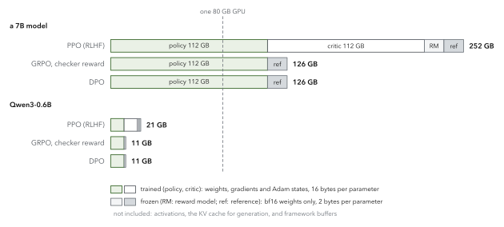

> **What shrinks it**: shard training states across GPUs (ZeRO, FSDP), recompute activations, train LoRA adapters (the reference is then the base with adapters off), or drop a model: GRPO drops the critic, a checker the reward model.

<!--
Where 16 bytes come from: half-precision weights and gradients (2 + 2) plus Adam's fp32 weights, momentum and variance (12). A frozen model needs only its 2-byte weights. Qwen3-0.6B fits on one GPU even for PPO; a 7B PPO run does not fit on one 80 GB GPU even before activations and the KV cache. For RL specifically, Thinking Machines' "LoRA Without Regret" (Sep 2025) reports LoRA matching full fine-tuning with policy-gradient training, even at rank 1.
-->

---

<!--
This is the picture behind every systems choice that follows: two jobs with different needs, sharing one set of weights. Continuous batching, which keeps the inference GPUs full, comes from Orca; vLLM adds paged KV-cache memory.
-->

<!-- _class: figure -->

## Generation dominates the time: a rollout engine and a trainer

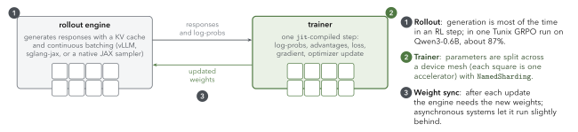

> OpenRLHF measured generation at 80% of training time. In OLMo 3, a 1,000-second RL step spent 125 seconds training, and the learner waited 75% of the time. Inference engines such as vLLM (paged KV cache) exist for exactly this.

<!--
This is where the experiments part picks up: what we run locally on CPU, what needs a GPU or TPU, and what we measure.
-->


---

<!-- _footer: "Yao et al., DeepSpeed-Chat, arXiv:2308.01320 (2023), §4; Sheng et al., HybridFlow, arXiv:2409.19256 (EuroSys 2025), §5–6; Hu et al., OpenRLHF, arXiv:2405.11143, v1 (2024), §2.1." -->

<!-- _class: figure -->

## Placing the two jobs: share the GPUs, or split them

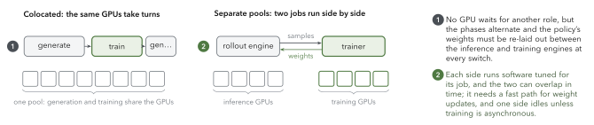

> DeepSpeed-Chat's Hybrid Engine and verl's 3D-HybridEngine switch the policy between inference and training layouts on the same GPUs. OpenRLHF spreads the models across GPUs with Ray and generates with vLLM. HybridFlow searches the placements in between.

---

<!-- _footer: "Mistral, Magistral, arXiv:2506.10910 (2025), §3; Noukhovitch et al., Asynchronous RLHF, arXiv:2410.18252 (ICLR 2025); Fu et al., AReaL, arXiv:2505.24298 (2025), §5; Piché et al., PipelineRL, arXiv:2509.19128 (2025); Team Olmo, OLMo 3 (2025), §4.4.3." -->

<!-- _class: figure -->

## Asynchronous RL keeps the GPUs busy, with slightly stale samples

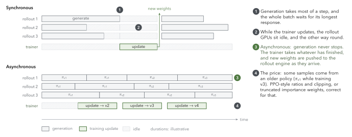

> Stragglers are real: in Magistral the longest completions take up to 5 times longer than the shortest. Asynchronous designs keep generating while the trainer updates; OLMo 3 reports in-flight updates up to 4 times faster without hurting accuracy.

<!--
Noukhovitch et al. found online DPO the most robust loss to off-policy data. PipelineRL pauses generation only briefly to load new weights, then continues the sequences in progress.
-->

---

<!-- _footer: "Yao, Liu, Zhang, Dong, Shang & Gao, Your Efficient RL Framework Secretly Brings You Off-Policy RL Training (2025), fengyao.notion.site/off-policy-rl; MiniMax, MiniMax-M1, arXiv:2506.13585 (2025), §3.2 and Fig. 3." -->

<!-- _class: concept -->

## The two engines disagree slightly about probabilities

#### What happens
The rollout engine (vLLM, SGLang) and the trainer (FSDP, Megatron) use different kernels and precision. With the same weights, they "can produce significantly different token probabilities".

#### Why it matters
The update treats the samples as the trainer's own, so the gap makes training slightly off-policy, even when nothing is stale.

#### Two fixes
**Truncated importance sampling**: weight each token by $\min(\pi_{\text{trainer}}/\pi_{\text{sampler}}, C)$. **Higher precision where it matters**: MiniMax-M1 computes the LM head in FP32, which raised the train–inference probability correlation from about 0.9 to 0.99.

---

<!-- _footer: "From each project's README or documentation, checked 2026-10-09; OPD = on-policy distillation. verl and AReaL now live at github.com/verl-project and github.com/areal-project." -->

<!-- _class: dense small -->

## Post-training frameworks in 2026

| Framework | From | Built on | Supports (as documented) |
|---|---|---|---|
| **TRL** | Hugging Face | Transformers, vLLM | GRPO, DPO, OPD, VLM GRPO; PPO removed in recent releases |
| **OpenRLHF** | community | Ray, vLLM, DeepSpeed | GRPO, PPO, DPO, VLM; asynchronous mode |
| **verl** | ByteDance Seed, now community | FSDP/Megatron; vLLM/SGLang | GRPO, PPO, OPD, VLM |
| **NeMo-RL** | NVIDIA | DTensor/Megatron; vLLM/SGLang | GRPO, PPO, DPO, OPD, VLM; asynchronous |
| **slime** | THUDM (GLM models) | Megatron, SGLang | GRPO, PPO, OPD; synchronous or asynchronous |
| **AReaL** | Tsinghua IIIS, Ant Group | asynchronous by design | GRPO, PPO, DPO, OPD, VLM |
| **prime-rl** | Prime Intellect | FSDP2, vLLM | GRPO variants, OPD, VLM; asynchronous |
| **SkyRL** | Berkeley Sky Lab, Anyscale | in-flight weight updates | GRPO, PPO, OPD, VLM; a JAX backend |
| **Tunix** | Google | JAX (Flax NNX), TPU | GRPO, PPO, DPO, agentic RL |
| **EasyDeL** | community | JAX (Flax NNX) | GRPO, DPO, GKD with on-policy generation |
| **Unsloth** | Unsloth AI | one GPU, memory-efficient | GRPO, DPO, VLM GRPO |
| **Tinker** | Thinking Machines | managed API, LoRA | primitives, with RL, DPO and distillation recipes |

<!--
Do not copy method expansions from READMEs: some spell out DAPO, Dr. GRPO or GSPO incorrectly. For this project: verl or TRL are the PyTorch references with VLM RL; Tunix or EasyDeL are the JAX options; neither JAX library documents VLM RL.
-->

---

<!-- _class: divider -->

###### Part 7

# JAX for post-training

Pure functions, composable transformations, and a GRPO step written with them.

---

<!-- _footer: "JAX documentation: Quickstart: How to think in JAX (docs.jax.dev)." -->

<!-- _class: figure -->

## JAX: composable transformations of pure functions

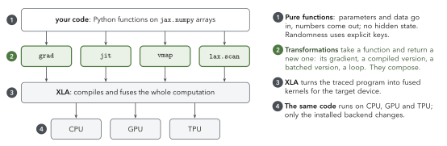

> JAX post-training libraries: **Tunix** (Google), **EasyDeL**, and **MaxText** for large-scale training; Part 6 lists what each supports.

<!--
For RL the useful transformations are grad for the loss, jit for the training step, vmap across the group of samples, and scan for the token-by-token decoding loop.
-->

---

<!-- _footer: "Code tested on CPU with JAX 0.11.2; Optax would replace the plain SGD line." -->

<!-- _class: dense -->

## A GRPO update in JAX

```python
def grpo_loss(params, batch, apply_fn, beta=0.0, eps=0.2):
    logits = apply_fn(params, batch["ids"])[:, :-1]          # scores for the next token
    logp = token_logprobs(logits, batch["ids"][:, 1:])        # log pi_theta(y_t | x, y_<t)
    adv = batch["adv"][:, None]                               # one advantage per response
    loss = clipped_pg_loss(logp, batch["logp_old"], adv, batch["mask"], eps)
    if beta > 0:                                              # optional KL penalty to pi_ref
        loss += beta * (kl_k3(logp, batch["logp_ref"]) * batch["mask"]).sum() / batch["mask"].sum()
    return loss

lr = 1e-2

@jax.jit
def train_step(params, batch):
    loss, grads = jax.value_and_grad(grpo_loss)(params, batch, apply_fn)
    params = jax.tree.map(lambda p, g: p - lr * g, params, grads)   # params are a pytree
    return params, loss
```

> `logp_old`, `logp_ref` and `adv` are plain arrays computed before the step; only `params` is differentiated. In practice the update uses an optimizer such as Adam (Optax).

<!--
Point out what is not there: no separate copy of the old policy, no critic. The reference model is needed only to compute logp_ref once per batch.
-->

---

<!-- _class: dense -->

## Summary

- **The policy gradient** weights each token's $\nabla \log \pi_\theta$ by an advantage. Everything else is about where that weight comes from.
- **RLHF** learns a reward from people's comparisons and optimizes it with PPO under a KL penalty; pushed too hard, the policy exploits the reward model. **DPO** solves the same objective in closed form and trains on the comparisons directly.
- **Reasoning**: chain-of-thought and test-time compute let a model spend tokens on a problem. **GRPO** with a checker (RLVR) trains it to spend them well, with no critic and no reward model.
- **On-policy distillation** gets a weight for every token from a teacher's log-probabilities; **self-distillation** uses the model itself, shown the solution.
- **Systems**: memory goes to the trained models and time goes to generation; frameworks differ in how they place and overlap the two jobs. **JAX** expresses each loss as a pure function, differentiated and compiled.

<!--
Transition: next, the experiments, where we run GRPO and on-policy distillation on a sub-1B model.
-->

<!-- include: experiments.md -->

---

<!-- _class: dense small -->

## Further reading

| To learn | Read |
|---|---|
| RL from scratch | OpenAI Spinning Up, Intro to RL Parts 1–3 · Karpathy, *Pong from Pixels* (2016) |
| RLHF, end to end | Lambert, *Reinforcement Learning from Human Feedback* (rlhfbook.com), ch. 5–8 · Hugging Face, *Illustrating RLHF* (2022) |
| PPO in detail | Schulman et al. (2017) · Huang et al., *The 37 Implementation Details of PPO* (ICLR blog track, 2022) |
| Preferences and DPO | Rafailov et al., *DPO* (2023), §4 and App. A · Weng, *Reward Hacking in Reinforcement Learning* (Lil'Log, 2024) |
| Reasoning and test-time compute | Wei et al., *Chain-of-Thought Prompting* (2022) · Snell et al., *Scaling LLM Test-Time Compute Optimally* (2024) · OpenAI, *Learning to Reason with LLMs* (2024) |
| GRPO and RLVR | Shao et al., DeepSeekMath (2024), §4 · Yuge Shi, *A vision researcher's guide to PPO & GRPO* (2025) · Raschka, *The State of RL for LLM Reasoning* (2025) |
| On-policy distillation | Thinking Machines, *On-Policy Distillation* (2025) · Agarwal et al., GKD (2023) · Zhao et al., OPSD (2026) |
| A full open recipe | Ai2, *Olmo 3* blog and technical report (2025) |
| Systems | Sheng et al., *HybridFlow* (2024) · Team Olmo, *OLMo 3* (2025), §4.4.3 · Yao et al., *Your Efficient RL Framework Secretly Brings You Off-Policy RL Training* (2025) |
| JAX | *How to think in JAX* (docs.jax.dev) · Flax NNX basics · Tunix documentation |

---

<!-- _class: divider -->

###### Appendix

# Details for self-study

Inside the decoder layer, and practical notes on GRPO.

<!-- include: experiments-appendix.md -->

---

<!-- _footer: "Elhage et al., A Mathematical Framework for Transformer Circuits (transformer-circuits.pub, 2021): the residual-stream view." -->

<!-- _class: figure -->

## How information moves between tokens

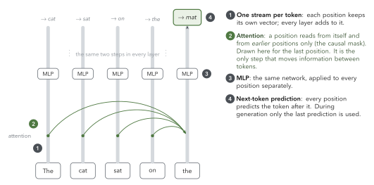

---

<!-- _footer: "Qwen3 report, arXiv:2505.09388, §2 (GQA, QK-Norm \"to ensure stable training\", RoPE, RMSNorm); config.json of Qwen/Qwen3-0.6B." -->

<!-- _class: figure -->

## Qwen3-0.6B attention: 16 query heads share 8 key/value heads

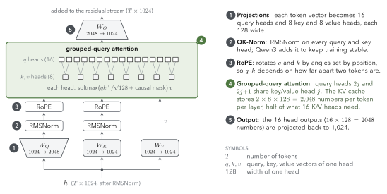

---

<!-- _footer: "Shazeer, GLU Variants Improve Transformer, arXiv:2002.05202 (2020); config.json of Qwen/Qwen3-0.6B." -->

<!-- _class: figure -->

## Qwen3-0.6B feed-forward: a gated MLP (SwiGLU)

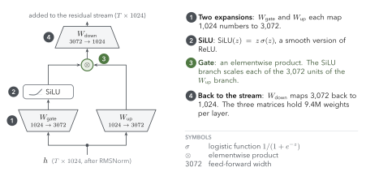

---

<!-- _footer: "Yu et al., DAPO, arXiv:2503.14476; Liu et al., Dr. GRPO, arXiv:2503.20783; Yao et al., Your Efficient RL Framework Secretly Brings You Off-Policy RL Training (2025); Team Olmo, OLMo 3, arXiv:2512.13961 (2025)." -->

<!-- _class: dense small -->

## Practical GRPO refinements used in 2025–2026 recipes

| Change | Problem it addresses | Source |
|---|---|---|
| Filter or resample prompts where all $G$ answers agree | all-correct or all-wrong groups give zero advantage | DAPO (dynamic sampling); OLMo 3 (active sampling) |
| Higher upper clip, $1+\varepsilon_{\text{high}}$ | entropy collapse: rare tokens can barely be pushed up | DAPO (clip-higher) |
| Average the loss over all tokens in the batch | long responses get less weight per token | DAPO (token-level loss) |
| Do not divide by the group's standard deviation | bias toward very easy and very hard prompts | Dr. GRPO |
| Drop the KL penalty | long reasoning moves the policy far from its start; DAPO finds the constraint unnecessary | DAPO; OLMo 3 |
| Correct for sampler–trainer mismatch (truncated importance sampling) | the inference engine and the trainer give slightly different log-probs | Yao et al.; OLMo 3 |

> OLMo 3's RL stage (OlmoRL) combines all six.
