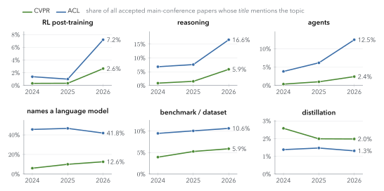
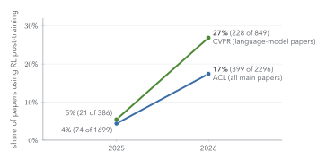
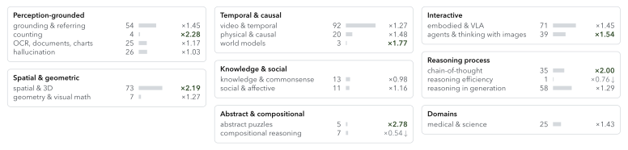
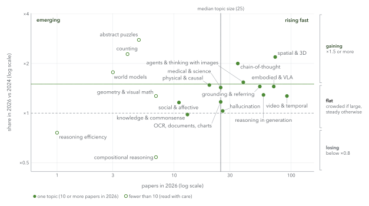
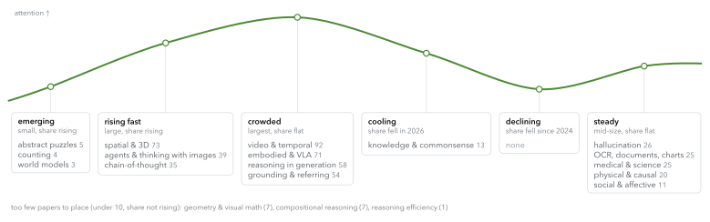
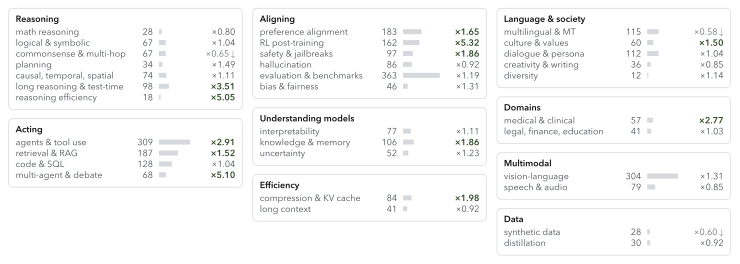
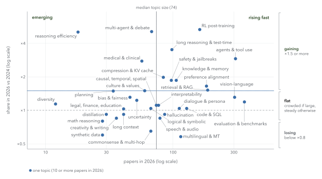
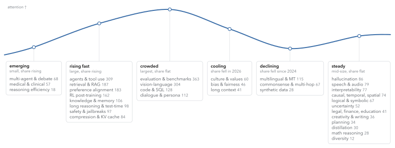
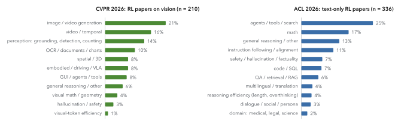

<!-- _class: title -->
<!-- _header: "" -->
<!-- _paginate: false -->

# The Problem Landscape at CVPR and ACL

What the main conferences accepted in 2025–2026, and where small-model RL post-training fits

**Prabakaran Chandran**

Engineer / Applied Researcher · pracha.me

<!--
Purpose: choose a research question with the venues' actual acceptances in view, not our impressions of them. Everything here comes from the complete accepted-paper lists, plus the venues' own calls and statistics.
-->

---

<!-- _class: topics -->

## Outline

1. **The two venues**
   - size, acceptance rates, next deadlines, rules that shape a paper
2. **Trends, 2024–2026**
   - which topics grew in accepted-paper titles
3. **Problem-space maps**
   - a taxonomy per venue; which topics are emerging, rising, crowded or fading
4. **What RL papers look like at each venue**
   - method family, modality, task, contribution type, model size, benchmarks
5. **Our focus**
   - crowded and open areas for small models × RL / OPD / OPSD; candidate questions

---

<!-- _footer: "Data: openaccess.thecvf.com (CVPR 2024–2026, all days); aclanthology.org volumes 2024–2026 acl-long + acl-short and 2025 emnlp-main. Fetched 2026-10-09." -->

<!-- _class: concept -->

## How the counts were made

#### Data
Every accepted **main-conference** paper: **CVPR** 2,716 / 2,871 / 4,042 and **ACL** 940 / 1,699 / 2,296 (2024 / 2025 / 2026), plus **EMNLP 2025** (1,809): 16,373 papers. ACL abstracts come from the Anthology; CVPR abstracts were fetched for the 1,234 papers whose title names a language model, an RL / preference / distillation method, or reasoning.

#### Tagging
Keyword rules on title and abstract, along four axes: **modality**, **method** (RL, preference optimization, distillation, self- and on-policy distillation, reward models), **primary task**, and **contribution type** (method, benchmark/dataset, analysis).

#### How far to trust it
The RL tag is about 88% precise on a hand-audited sample, so read counts as close upper bounds. Task tags are coarser (about 75–80%). Title-only shares compare all venues exactly; abstract-level shares cover CVPR's language-model papers only.

<!--
The method write-up, the scripts and a CSV lists every paper with its tags, so any number on the following slides can be opened and checked.
-->

---

<!-- _footer: "CVPR: cvpr.thecvf.com/Conferences/2025/News/Technical_Program and /2026/News/Technical_Program. ACL: program-chair messages, aclanthology.org/2025.acl-long.0 and 2026.acl-long.0." -->

<!-- _class: dense small -->

## Two large venues, growing fast, both accepting about one paper in five

| | CVPR 2025 | CVPR 2026 | ACL 2025 | ACL 2026 |
|---|---|---|---|---|
| Submissions | 13,008 | 16,092 | 8,360 | 12,148 |
| Accepted, main conference | 2,872 | 4,089 | 1,699 | 2,296 |
| Acceptance rate | ≈ 22% | ≈ 25% | 20.3% | 18.9% |
| Second tier | — | Findings Track (new) | 1,392 Findings | 2,163 Findings |
| Theme track | — | — | Generalization | Explainability |

> CVPR grew 24% in submissions from 2025 to 2026, and ACL 45%. A typical accepted paper now competes with many recent papers on the same topic, which raises the bar for "we apply method X to task Y".

<!--
The open-access list has 4,042 CVPR 2026 papers against 4,089 accepted; the difference is papers not on the open-access site. The analysis uses the open-access lists.
-->

---

<!-- _footer: "cvpr.thecvf.com/Conferences/2027/CallForPapers and /Dates; aclrollingreview.org/dates, /cfp, /sustainable-reviewing-2026, /responsibleNLPresearch; 2027.aclweb.org/calls/main; 2027.naacl.org." -->

<!-- _class: dense small -->

## The next deadlines, and the rules that shape the paper

| | CVPR 2027 (Seattle, June 20–25) | ACL 2027 (Kyoto, Aug 17–22) via ARR |
|---|---|---|
| Deadline | registration **Nov 10, 2026**; paper **Nov 16** (no extension) | ARR **Jan 4, 2027** (the Oct 12 cycle feeds NAACL 2027) |
| Days from today | 32 / 38 | 87 |
| Length | 8 pages + references (2026 rule; 2027 page not yet published) | 8 pages long, 4 short, plus a required Limitations section |
| Prior work | anything online **before Sept 15, 2026** must be discussed; arXiv counts as published | no anonymity period; preprints allowed |
| Topic fit | new topic **"Reasoning & Reinforcement Learning"** | no RL area: ML for NLP, LLM Agents, Efficient Methods, Interpretability |
| Reviewing | all authors must review; LLM use in reviewing being finalised | each submission names a reviewer; ≤ 5 first-author papers per cycle |
| Reproducibility | voluntary compute reporting (2026) | checklist: compute budget, hyperparameter search, **error bars** |
| Theme | — | **"Homogenization and knowledge collapse in LLMs"** |

> The ACL 2027 theme maps directly onto RL questions such as sharpening, entropy collapse and narrowing pass@k.

---

<!-- _class: divider -->

###### Part 2

# Trends, 2024–2026

Which topics grew in the titles of accepted papers.

---

<!-- _footer: "Share of all accepted main-conference papers whose title matches the topic's keywords (taxonomy in the notes). CVPR n = 2,716 / 2,871 / 4,042; ACL n = 940 / 1,699 / 2,296." -->

<!-- _class: figure tall -->

## RL, reasoning and agents jumped in 2026 at both venues

> 2026 is the first full year of R1-style work (DeepSeek-R1 came out between the CVPR 2025 and ACL 2025 deadlines). Distillation stayed flat at both venues.

<!--
Read each panel as a share of the whole conference, not of the language-model papers. A 2.6% share at CVPR is still 107 papers.
-->

---

<!-- _footer: "Title + abstract tags. CVPR scope: papers whose title names a language model, an RL/preference/distillation method, or reasoning (386 in 2025, 849 in 2026). ACL scope: all main papers. RL-tag precision ≈ 88% on an audited sample." -->

<!-- _class: figure -->

## Among language-model papers, RL went from rare to common in one year

> At CVPR 2026, roughly one language-model paper in four uses RL post-training; at ACL 2026, one main paper in six.

<!--
The two scopes differ (CVPR's language-model papers vs all of ACL), so compare each venue with itself across years, not the two venues with each other.
-->

---

<!-- _class: divider -->

###### Part 3

# Problem-space maps

A taxonomy for each venue, and where each topic sits: emerging, rising, crowded or fading.

---

<!-- _footer: "Share = topic papers ÷ scope papers that year, with +0.5 smoothing so a topic absent in 2024 has a finite ratio. Rules are applied top to bottom; median and top quarter are over each venue's topics." -->

<!-- _class: dense small -->

## How to read the maps: a rule, by analogy with a hype cycle

| Phase | Rule (2026 papers; share vs 2024) | What it usually means for a new paper |
|---|---|---|
| **too few to call** | under 10 papers, share not ×1.5 | the count is too small to read |
| **emerging** | below the median size, share ×1.5 or more (under 10 papers allowed) | room to define the problem; the paper must show it matters |
| **declining** | share below ×0.8 since 2024 | a hard sell, unless it brings a new angle |
| **cooling** | share below ×0.8 since 2025 | attention is moving elsewhere |
| **rising fast** | median size or more, share ×1.5 or more | reviewers are primed; concurrent work arrives monthly |
| **crowded** | top quarter by size, share flat | high bar: a sharp angle or a control others skip |
| **steady** | the rest: mid-size, share flat | established; reviewers know the baselines |

**Scope.** CVPR: the visual-reasoning papers, i.e. those whose title mentions reasoning or a language model (VLM, MLLM, VQA, …): 168 / 309 / 664 in 2024 / 2025 / 2026. ACL: all main papers, 940 / 1,699 / 2,296. Topics come from title keywords, and a paper can carry several.

<!--
This is publication attention, not a survey of researchers or a forecast. The phase is assigned by the rule, not by judgment; the right-hand column is a heuristic for reading it, and yours to overrule.
-->

---

<!-- _footer: "Scope: CVPR papers whose title mentions reasoning or a language model (664 in 2026). Number = 2026 papers; × = share in 2026 ÷ share in 2024; bold: ×1.5 or more; ↓: below ×0.8." -->

<!-- _class: figure tall -->

## A taxonomy of visual reasoning at CVPR 2026

> The largest visual-reasoning topics are video (92), spatial & 3D (73) and embodied / VLA (71). Spatial & 3D and chain-of-thought both doubled their share since 2024.

<!--
Read the × column as a change in share, so it already corrects for the visual-reasoning scope growing fourfold (168 to 664 papers). Visual math is small at CVPR: 7 titles in 2026, about 5 of them really about math or diagrams.
-->

---

<!-- _footer: "x: 2026 papers (log scale). y: share in 2026 ÷ share in 2024 (log scale). Dotted lines: median topic size and ×1.5. Hollow: fewer than 10 papers." -->

<!-- _class: figure tall -->

## CVPR: spatial and chain-of-thought rise; video and embodied are largest

---

<!-- _footer: "Phase assigned by the rule on the reading slide. Within a card, topics are listed by 2026 paper count." -->

<!-- _class: figure tall -->

## CVPR visual reasoning on the attention cycle

> Counting, abstract puzzles and world models are small and rising (3–5 papers): open, but not yet an established CVPR topic. Knowledge & commonsense is cooling (15 papers in 2025, 13 in 2026).

---

<!-- _footer: "Scope: all ACL main papers (2,296 in 2026). Number = 2026 papers; × = share in 2026 ÷ share in 2024; bold: ×1.5 or more; ↓: below ×0.8." -->

<!-- _class: figure tall -->

## A taxonomy of problem spaces at ACL 2026

> Evaluation & benchmarks is the largest topic (363 papers, 16% of ACL 2026). RL post-training grew the most (×5.3), then multi-agent (×5.1) and reasoning efficiency (×5.1).

---

<!-- _footer: "x: 2026 papers (log scale). y: share in 2026 ÷ share in 2024 (log scale). Dotted lines: median topic size and ×1.5." -->

<!-- _class: figure tall -->

## ACL: RL, agents and long reasoning rise fastest; evaluation is largest

---

<!-- _footer: "Phase assigned by the rule on the reading slide. Within a card, topics are listed by 2026 paper count." -->

<!-- _class: figure tall -->

## ACL problem spaces on the attention cycle

> Multilingual, commonsense QA and synthetic data are losing share. Culture, bias and long context rose in 2025, then fell in 2026. Distillation is steady and small (30 papers, ×0.92).

---

<!-- _class: divider -->

###### Part 4

# What RL papers look like at each venue

Method family, modality, task, contribution type, model size, benchmarks.

---

<!-- _footer: "Title + abstract keyword tags; one paper can carry several methods. Scopes as on the previous slide." -->

<!-- _class: dense small -->

## RL dominates; on-policy and self-distillation are nearly absent from main conferences

| | CVPR 2025 | CVPR 2026 | ACL 2025 | ACL 2026 |
|---|---|---|---|---|
| Papers in scope | 386 | 849 | 1,699 | 2,296 |
| RL post-training | 21 | **228** | 74 | **399** |
| Preference optimization (DPO family) | 24 | 41 | 84 | 71 |
| Reward models (incl. process reward) | 7 | 40 | 55 | 69 |
| Distillation, any kind | 69 | 106 | 50 | 128 |
| Self-distillation | 3 | 6 | 2 | 7 |
| On-policy distillation | 0 | 4 | 0 | 0 |

> **Preference optimization is flat or shrinking while RL grows five- to tenfold.** Every on-policy distillation paper in these lists is from CVPR 2026, for example VOLD. At ACL 2026 it appears only in Findings.

<!--
The ACL brief found on-policy and self-distillation at ACL 2026 only in Findings (e.g. 2026.findings-acl.1276). This is the thinnest cell in the whole table, and the one closest to our deck.
-->

---

<!-- _footer: "Modality: RL papers whose title or abstract mentions images, video, visual input or a VLM/MLLM. Primary task: the first matching task in the title (abstract if the title names none), in a fixed priority order; ≈ 75–80% plausible on an audited sample." -->

<!-- _class: figure -->

## The same method, different problems: 92% of CVPR's RL papers involve vision, 84% of ACL's are text-only

> **CVPR** applies RL to generation, video, perception and documents. **ACL** applies it to agents and search, math and alignment. Visual math is a small slice of CVPR's RL work (4%).

<!--
This is the most useful slide for choosing a venue: the same GRPO machinery is aimed at different problems. A perception question belongs at CVPR; an agent or math-reasoning question at ACL.
-->

---

<!-- _footer: "Contribution type from title and abstract cues (benchmark: 'bench / dataset' or 'we introduce a benchmark'; analysis: question titles, 'rethinking', 'empirical study'). Sizes: model sizes named in the abstract; only some abstracts name one." -->

<!-- _class: dense small -->

## RL papers are mostly methods; small models are rare

| | CVPR 2026: all in scope | CVPR 2026: RL papers | ACL 2026: all | ACL 2026: RL papers |
|---|---|---|---|---|
| Papers | 849 | 228 | 2,296 | 399 |
| Method | 83% | 85% | 71% | 87% |
| Benchmark / dataset | 13% | 10% | 18% | 6% |
| Analysis / study | 5% | 5% | 11% | 7% |
| Explicitly small models (≤ 2B, or "small", "lightweight", "on-device") | — | **8%** | — | **12%** |

- **Analysis papers are rare in RL work at both venues**, about 1 in 15. Yet some of the most discussed RL results of 2025 are analyses: Yue et al.'s "Does RL really incentivize reasoning…" was a NeurIPS 2025 Best Paper runner-up.
- **Named model sizes cluster at 3–8B**: Qwen2.5-VL-3B/7B at CVPR; mostly 7B-class Qwen models at ACL, with a minority at 1–1.5B (e.g. R1-Distill-Qwen-1.5B, Llama-3.2-1B). At CVPR, ≤ 2B models appear mainly as one point in a size sweep.

---

<!-- _footer: "Benchmarks named in RL-paper abstracts, CVPR and ACL 2025–2026 (abstracts name only some of the benchmarks a paper reports), plus benchmarks reported by the example papers on the next slides." -->

<!-- _class: dense small -->

## The benchmarks each community reports

| | CVPR RL papers | ACL RL papers |
|---|---|---|
| Reasoning | MMMU, MathVista, MathVerse, MathVision | AIME, GSM8K, MATH500, MMLU |
| Perception | HallusionBench, BLINK; spatial suites (VSI-Bench, MindCube) | — |
| Video | Video-MME, MVBench | — |
| Documents | OmniDocBench, chart benchmarks | — |
| Agents / code | LIBERO (VLA) | ALFWorld, WebShop, BFCL, HumanEval, MBPP, LiveCodeBench |
| Generation / alignment | GenEval, T2I-CompBench | AlpacaEval |

> Most-named in abstracts: **CVPR**: MMMU, Video-MME, GenEval (5 each), then MathVista (4). **ACL**: AIME (8), ALFWorld (6), HumanEval (5). Abstracts name only a few benchmarks, so these counts show which benchmarks are named most, not how much each is used.

---

<!-- _footer: "cvpr.thecvf.com/Conferences/2025/BestPapersDemos, /2026/News/Best_Papers, /2026/ReviewerGuidelines; 2025.aclweb.org/program/awards; 2026.aclweb.org/program/best_papers; aclrollingreview.org/reviewerguidelines." -->

<!-- _class: dense small -->

## What each venue rewards

| | CVPR | ACL |
|---|---|---|
| Best papers and honorable mentions 2025–2026 | 3D and geometry foundation models (VGGT, D4RT); open models and data (Molmo + PixMo); navigation world models | analysis, theory and linguistics (response sampling, local-attention expressivity, the imperfective paradox) |
| RL among the awards | none | 3 of 18 ACL 2026 Outstanding Papers are RLVR: GeoRA, Rethinking Entropy Interventions (STEER), CURE |
| Reviewers told | not beating SOTA "is not grounds for rejection by itself"; "embrace novel, brave concepts"; incremental work goes to Findings | "SOTA results are neither necessary nor sufficient"; negative results are valid; overclaiming "reasoning" from a few QA benchmarks is a weakness; soundness and excitement scored separately |

> At ACL, a method wins when it explains a mechanism (STEER derives how entropy changes). At CVPR, no RL post-training or small-VLM paper won an award in 2025–2026.

---

<!-- _footer: "CVPR 2026 accepted papers, each checked on openaccess.thecvf.com." -->

<!-- _class: dense small -->

## Paper types CVPR accepts in RL for vision

| Type | CVPR 2026 example | What it needs |
|---|---|---|
| Analysis of RL post-training | *Understanding the Role of Hallucination in RL Post-Training*; *Why Does RL Generalize Better Than SFT?* | a falsifiable hypothesis, controlled interventions, ≥ 2 model sizes, a fix that confirms the explanation |
| Reward or algorithm change aimed at perception | PEARL; APPO | GRPO / DAPO baselines at matched compute; ablation of each reward term |
| Verifiable data or task construction | Spatial-SSRL; ReVeL (MCQ options leak the reward) | a scalable pipeline, broad gains, released data |
| Benchmark plus baseline | AV-Reasoner | a failure existing benchmarks miss; data public by camera-ready |
| Cheaper RL | MSSR (single rollout); VideoAuto-R1 | the same accuracy with fewer steps or tokens; stability curves |
| Small-model phenomenon plus fix | *Downscaling Intelligence*; VideoThinker-R1 | a size sweep that isolates the effect |
| Distillation into compact students | VOLD (on-policy, from a text teacher); Masters | teacher/student sweeps and a GRPO-only baseline |

---

<!-- _footer: "ACL / EMNLP papers, each checked on aclanthology.org (IDs as shown)." -->

<!-- _class: dense small -->

## Paper types ACL accepts in RL for language

| Type | Example | What it needs |
|---|---|---|
| Controlled analysis of an RL claim | *Why does RL generalize?* (2026.acl-long.1808); RLVR boundaries in VLMs (2026.acl-long.2102) | same base and data across arms, pass@k to large k, out-of-distribution sets, seeds |
| Training-dynamics mechanism plus fix | STEER, Outstanding Paper (2026.acl-long.1436) | a derivation, two or more model families, math and code; crowded, so a unifying account |
| Small-model learnability or negative result | *Small Models Struggle to Learn from Strong Reasoners* (Findings); *Through the Valley* (EMNLP'25) | ≤ 3B, several families, data-scale sweeps |
| Efficiency of RL or distillation | ARRoL rollout pruning; GeoRA | FLOP or wall-clock accounting, equal-budget baselines |
| Scaling study | scaling behaviour of RL post-training, Qwen2.5 0.5B–72B (2026.acl-long.1444) | a size ladder from 0.5B, laws checked on held-out sizes |
| Theme fit, ACL 2027 | homogenization and knowledge collapse | diversity metrics; exploration vs convergence |

> At ACL the language side must carry the claim: a score of 1 means "in no way related to computational processing of language".

---

<!-- _class: divider -->

###### Part 5

# Our focus

Small models × RL / OPD / OPSD × vision or language.

---

<!-- _footer: "Counts from this survey; papers checked via the arXiv API and the venues' sites. Crowded or open describes 2026 main-conference papers plus arXiv up to 2026-10-09." -->

<!-- _class: dense small -->

## Where our focus sits: crowded at 3–8B, thin at ≤ 2B

| | GRPO / RLVR | On-policy distillation (OPD) | On-policy self-distillation (OPSD) |
|---|---|---|---|
| **Vision, 3–8B** | **crowded**: ≈ 210 CVPR 2026 vision RL papers, mostly Qwen2.5-VL-3B/7B | emerging: VOLD (CVPR'26, 3B student); Decomposed OPD (ICML'26) | **crowded since May 2026**: Vision-OPD, RP-OPSD, S²VOPD, VAD, CW-OPD, all ≥ 4B |
| **Vision, ≤ 2B** | **thin**: mostly one point in size sweeps (TTRV, Masters); VisualThinker-R1-Zero at 2B | VA-OPD: Qwen3-VL-2B student; no seeds or image-removed evaluation reported | **open**: no paper found |
| **Language, small** | **accepted** as learnability, scaling or negative-result studies; entropy work is crowded (≥ 15 ACL'26 titles, main + Findings) | thin: Findings only at ACL'26; EOPD at 0.6B (ICML'26) | OPSD tested down to 1.7B; can hurt thinking models (one seed) |

**A control nobody runs at ≤ 2B:** training with the image removed or replaced by a blank. A paper posted Oct 1, 2026 (arXiv:2610.01908) shows RLVR trained on gray canvases instead of images keeps 52% (3B) and 78% (7B) of the real-image gain. It is the right control for any "RL improves perception" claim, and it is untested at ≤ 2B.

<!--
The pattern: the 3–8B vision cells are full; the ≤2B cells are thin. Under CVPR's prior-work rule, anything posted before Sept 15, 2026 must be compared against, so the crowded cells raise the bar further.
-->

---

<!-- _footer: "Compute figures are our estimates, anchored on reported small-model runs (e.g. 120 GPU-hours for GRPO on a 2B VLM, arXiv:2504.00883; OPSD with LoRA on 8 GPUs, arXiv:2601.18734)." -->

<!-- _class: dense small -->

## Candidate questions, vision side (options, not ranked)

| # | Question | Why it is open | Minimal experiment | H100-hours |
|---|---|---|---|---|
| V1 | Does the blank-image gain hold at ≤ 2B, and does it differ between GRPO, OPD and OPSD? | shown only at ≥ 3B with the encoder frozen | {real, blank, none} × {GRPO, OPD, OPSD} × 3 seeds | 250–450 |
| V2 | Is there a crop-vs-full-image gap at ≤ 2B, the precondition for crop-privileged OPSD? | all privileged visual OPSD papers are ≥ 4B | measure the gap, then compare crop-OPSD, GRPO at matched tokens | 100–250 |
| V3 | Visual reliance under OPD vs GRPO vs SFT at matched compute, 2B student | VA-OPD reports no seeds or image-removed evaluation | 8B → 2B; image-removed accuracy delta; 3 seeds | 200–400 |
| V4 | Does RL in thinking vs non-thinking mode change which tasks improve at 0.8B? | the Qwen3.5-0.8B card: thinking helps counting, hurts OCR | GRPO per mode on counting and charts; 3 seeds | 100–200 |
| V5 | Does RLVR change a small VLM's vision encoder? | the blank-image paper froze the encoder | frozen / LoRA / full encoder; linear probes | 100–200 |
| V6 | Where are the pass@k limits for perception vs reasoning in a small VLM? | pass@k studies are at ≥ 7B and rarely report confidence intervals | base vs GRPO vs OPD, pass@1–256, 0.8B | 80–200 |

---

<!-- _footer: "L-questions fit ACL (ARR, Jan 4, 2027). Compute estimates are ours. State-distribution paper: arXiv:2605.22731; EOPD: arXiv:2603.07079." -->

<!-- _class: dense small -->

## Candidate questions, language side (options, not ranked)

| # | Question | Why it is open | Minimal experiment | H100-hours |
|---|---|---|---|---|
| L1 | Does OPSD work below 1.7B, and does thinking mode flip its sign? | OPSD tested down to 1.7B; the harm to thinking models rests on one seed | Qwen3-0.6B, thinking on/off; OPSD vs GRPO vs SFT at matched tokens; 3–5 seeds | 50–150 |
| L2 | Does the state-distribution effect survive seeds and a disentangling control? | 2605.22731: one GPU, seeds not reported | replicate at 0.6B with 5 seeds, plus SFT on student-visited states | 30–80 |
| L3 | Does OPD still help an already-distilled small model? | Qwen3's small models were already distilled on-policy | {base, post-trained} × {OPD from 8B, GRPO}; teacher–student KL as a predictor | 60–150 |
| L4 | Do entropy dynamics in RLVR depend on size and difficulty below 1B? | entropy laws measured on larger models; crowded area | 0.6B vs 1.7B on difficulty ladders; track entropy and pass@k | 80–200 |
| L5 | How much does a small judge get reward-hacked at 0.6B? | measured at ≥ 2B | rule verifier vs small judge vs robust reward model | 80–180 |

> **Theme fit:** L1, L4 and V6 speak directly to ACL 2027's "homogenization and knowledge collapse" theme.

---

<!-- _footer: "Topics and phases from the problem-space maps (Part 3). A candidate can touch several topics; the phase is the topic's, not the candidate's." -->

<!-- _class: dense small -->

## Where the candidate questions sit on the maps

| Candidate | Closest problem topic (2026 papers, phase) |
|---|---|
| **V1, V3**: visual reliance, blank-image control | CVPR hallucination & faithfulness (26, steady) |
| **V2**: crop-privileged OPSD | CVPR agents & thinking with images (39, rising fast) |
| **V4**: thinking vs non-thinking at 0.8B | CVPR chain-of-thought (35, rising fast); counting (4, emerging); OCR, documents, charts (25, steady) |
| **V5, V6**: encoder change; pass@k | not a task topic: analyses of the model, spanning tasks |
| **L1, L2**: OPSD below 1.7B; state distribution | ACL RL post-training (162, rising fast) × distillation (30, steady) |
| **L3**: OPD on already-distilled models | ACL distillation (30, steady) |
| **L4**: entropy dynamics | ACL RL post-training (rising fast); long reasoning & test-time (98, rising fast) |
| **L5**: small-judge reward hacking | ACL evaluation & LLM judges (363, crowded); preference alignment (183, rising fast) |

**The pattern.** At ACL, the method side (RL post-training, ×5.3) is rising fast while distillation is small and flat (×0.92). OPD and OPSD sit where the two meet.

<!--
This places options; it does not rank them. A rising topic brings reviewer interest and concurrent work at the same time.
-->

---

<!-- _footer: "Yue et al., arXiv:2504.13837 (NeurIPS'25 Best Paper runner-up); Spurious Rewards, arXiv:2506.10947; arXiv:2607.12640; arXiv:2610.01908. ACL Responsible NLP checklist C3 (error bars)." -->

<!-- _class: concept -->

## What makes a small-model phenomenon study convincing

#### Common ingredients of the RL analyses that were well received
1. **A cheap causal control**: a blank image, a random reward, or a positive control where the effect must appear.
2. **Seeds and intervals**: three or more training seeds, and confidence intervals on the key contrast.
3. **Two model families**: a Qwen-only result invites the "spurious rewards" critique.
4. **A mechanism measurement**: entropy, attention to visual tokens, or linear probes.
5. **Budgets matched explicitly**: rollouts, generated tokens or FLOPs, stated per arm.

#### Why it suits ≤ 2B
Small models make seeds and controls affordable: by our estimate, a 12–30-run grid at ≤ 2B costs about 150–500 H100-hours. The risk to manage is the reviewer's question "does it hold at 7B?", so one 7B point (or a cited 7B result) belongs in the plan.

---

<!-- _class: dense -->

## Decisions for you

- **Venue and date.** CVPR 2027 (registration Nov 10, paper Nov 16: 32 / 38 days) suits the V-questions. ACL 2027 via ARR (Jan 4, 2027: 87 days) suits the L-questions and its theme.
- **Contribution type.** A phenomenon study with controls, a method aimed at a diagnosed failure, or both (diagnose, then fix).
- **Model and stack.** Qwen3.5-0.8B or Qwen3-VL-2B (vision), Qwen3-0.6B (language). Vision RL in JAX needs an image path wired into GRPO first, which competes with the CVPR window.
- **Which cell.** Among the thin cells: ≤ 2B vision RL with the blank-image control (V1, V3); OPSD below 1.7B (L1); OPD on already-distilled models (L3).

<!--
These are options with evidence attached; the choice is yours. The accompanying notes hold the full briefs, the per-paper CSV and the scripts.
-->

---

<!-- _class: divider -->

###### Appendix

# Data and method details

---

<!-- _footer: "The scripts and a per-paper CSV of tags accompany this survey." -->

<!-- _class: dense small -->

## Taxonomy and audit

| Axis | Rule (keywords in title + abstract) |
|---|---|
| RL post-training | reinforcement learning or fine-tuning, RL, RFT, GRPO, PPO, DAPO, GSPO, RLVR, verifiable rewards, policy optimization, RLHF, RLAIF |
| Preference optimization | DPO, KTO, ORPO, SimPO, preference optimization |
| Distillation / self- / on-policy | "distil"; "self-distil"; on-policy distillation, OPD, OPSD, GKD |
| Vision | vision-language, VLM, MLLM, LVLM, multimodal, visual, image, video, vision |
| Primary task | first match in the title (else abstract) in a fixed priority order; separate vision and language task lists |
| Contribution | benchmark: bench / dataset / evaluation in the title, or "we introduce a … benchmark"; analysis: question titles, rethinking, empirical study |

**Audit.** The first RL rule, which also matched bare "reward" and R1 model names, was about 75% precise on 40 papers. The final rule is about 88% precise (26–27 of 30). Task tags are about 75–80% plausible (11–12 of 15 per venue). The "code is available at …" sentences are removed before tagging.

**Problem-space topics (2026 title samples on target).** CVPR counting 4/4, chain-of-thought 10/10, agents 10/10; geometry & visual math 5/7 after removing a bare "geometr" keyword (3/10 before). ACL RL, multi-agent, distillation, reasoning efficiency 10/10 each.
